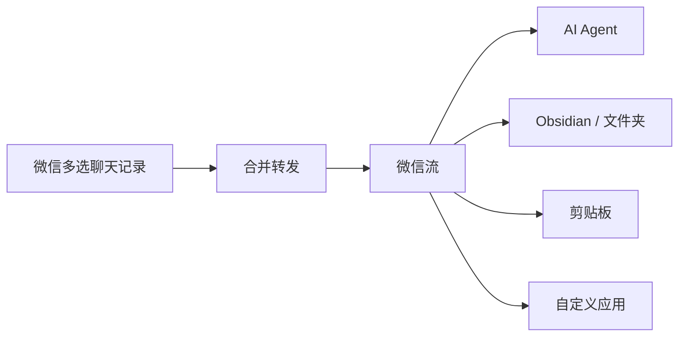

<div align="center">
  
  <h1>WeChatBridge（微信流）</h1>
  <p><strong>群里几百条消息没空翻？多选、转发，一步交给 AI 总结，或存进你的知识库。</strong></p>
  <p>在微信「转发到其他应用」里直接选 Codex、Claude、豆包、千问、Obsidian……不读数据库、不注入微信，全程本地。</p>

  <p>
    <a href="#下载安装"></a>
    <a href="#加入交流群"></a>
    <a href="https://github.com/freestylefly/WeChatBridge/stargazers"></a>
    <a href="LICENSE"></a>
  </p>

  <p>
    <a href="#下载安装"><strong>下载</strong></a> ·
    <a href="#加入交流群"><strong>交流群</strong></a> ·
    <a href="USAGE.zh-CN.md">使用指南</a> ·
    <a href="https://render.qmuse.pub/p/muse/2413870555736078">官网</a> ·
    <a href="README_EN.md">English</a>
  </p>

  
  <br />
  <sub>多选群聊 → 转发到其他应用 → 选「发给 Codex」和场景 → Agent 收到聊天记录并开始总结</sub>
</div>

## 它能帮你做什么

<table>
  <tr>
    <th align="center" width="33%">群聊一键交给 AI</th>
    <th align="center" width="33%">沉淀进知识库</th>
    <th align="center" width="33%">一个群一个场景</th>
  </tr>
  <tr>
    <td align="center"></td>
    <td align="center"></td>
    <td align="center"></td>
  </tr>
  <tr>
    <td><sub>转发到 Codex、Claude、豆包、千问办公、WorkBuddy 等，自动带上提示词并粘贴好聊天记录，回车就出总结、待办和纪要。</sub></td>
    <td><sub>一键存成 Obsidian 笔记或任意文件夹里的 Markdown，图片和附件原样保留，按聊天名归档。</sub></td>
    <td><sub>给不同的群存好各自的提示词，比如「群聊总结」「日常摘要」，转发时选一个就行；还能给 Agent 装技能包，读懂群里的链接和视频。</sub></td>
  </tr>
</table>

超过 100 条也不怕：微信一次最多转发 100 条，用「分批收集到微信流」分几批选，收齐后一次发出去。

<div align="center">
  
  <br />
  <sub>内置十二个入口，还能添加任意应用作为自定义目标</sub>
</div>

## 三步上手

1. **安装**：从下面的蓝奏云链接下载，macOS 把「微信流」拖进「应用程序」。
2. **打开入口**：在「微信流 → 设置 → 入口」里勾选要用的目标，例如「发给 Codex」「沉淀到 Obsidian」。
3. **转发**：在微信里多选聊天记录 →「合并转发」→「转发到其他应用」→ 选择微信流的入口。

需要 macOS 微信 4.1.13 或更高版本。完整步骤、权限说明和常见问题见 [使用指南](USAGE.zh-CN.md)。

## 下载安装

免费下载，全部安装包通过蓝奏云发布，提取密码都是 **`向明`**：

| 平台 | 下载地址 | 提取密码 |
| --- | --- | --- |
| macOS 14+（Apple Silicon 与 Intel） | [wwbsr.lanzout.com/b0umjur8h](https://wwbsr.lanzout.com/b0umjur8h) | `向明` |
| Windows | [wwbsr.lanzout.com/b0umjur4d](https://wwbsr.lanzout.com/b0umjur4d) | `向明` |

macOS 版打开 DMG，把「微信流」拖入「应用程序」即可；Windows 版解压后按目录内说明运行。iOS 版正在开发中，进群可以第一时间知道进展。

## 加入交流群

<table>
  <tr>
    <td width="300" align="center">
      
      <br />
      <sub>微信扫码加入</sub>
    </td>
    <td>
      <strong>进群你可以：</strong>
      <ul>
        <li>第一时间拿到新版本和新平台（iOS 等）的消息</li>
        <li>遇到装不上、找不到入口、粘贴失败，直接问开发者</li>
        <li>拿到群友在用的场景提示词和技能包，抄作业比自己写快</li>
        <li>提需求：你想把聊天记录送到哪个应用，告诉我们</li>
      </ul>
      二维码过期的话，扫下方「关于我们」里苍何的微信，备注「微信流」。
    </td>
  </tr>
</table>

## 为什么做微信流

macOS 微信 4.1.13 起，多选聊天记录后可以「合并转发」给第三方应用：微信会生成一份包含 TXT、图片和视频的 ZIP，正好适合交给 AI Agent 处理，或沉淀进本地知识库。

但系统的「转发到其他应用」列表只显示带有 Share Extension 的应用，大多数 AI 工具并不在里面。微信流补上了这层入口，让一次转发直接到达你常用的 Agent、Obsidian、剪贴板或你指定的任何应用。



## 全部功能

<details>
<summary><strong>核心能力</strong></summary>

| 能力 | 使用体验 |
| --- | --- |
| 十二个原生入口 | 在微信转发菜单直接选择目标，无需打开微信流主窗口 |
| AI Agent 转发 | 激活目标应用，附加场景指令并自动粘贴聊天归档 |
| Obsidian 沉淀 | 生成 Markdown 笔记，保存原始 ZIP，并按聊天名组织内容 |
| 自定义目标 | 添加任意 macOS 应用，终端类应用可只接收文件路径 |
| 场景与技能 | 为不同群聊保留场景提示词，并管理兼容 Agent 的 `SKILL.md` |
| 本地记录 | 查看批次状态、重新发送、复制、定位文件和清理历史 |
| 失败兜底 | 目标未安装或权限不足时，文件仍会保留在剪贴板 |
| 双语界面 | 完整支持简体中文与 English |

</details>

<details>
<summary><strong>十二个内置入口</strong></summary>

| 入口 | 行为 |
| --- | --- |
| 发给 Codex | 激活 ChatGPT/Codex 并粘贴聊天归档 |
| 发给 Claude | 激活 Claude 并粘贴聊天归档 |
| 发给豆包 | 激活豆包并粘贴聊天归档 |
| 发给千问办公 | 激活千问办公并粘贴聊天归档 |
| 发给 WorkBuddy | 激活 WorkBuddy 并粘贴聊天归档 |
| 发给 WeSight | 激活 WeSight 并粘贴聊天归档 |
| 发给 DeepSeek Harness | 激活 DeepSeek Harness 并粘贴聊天归档 |
| 沉淀到 Obsidian | 创建 Markdown 笔记并保存原始附件，通知可打开笔记 |
| 沉淀到文件夹 | 写入选定目录中的 Markdown 与附件，通知可在访达中定位 |
| 分批收集到微信流 | 连续分享多批原始 ZIP，收齐后一次选择目标和场景 |
| 复制到剪贴板 | 保留文件，交给用户手动粘贴 |
| 发送到自定义 | 转发到用户维护的应用列表 |

分批收集时，每批在微信手动选取并分享到「分批收集到微信流」。浮条显示已收批次和上一批首尾参考；收齐后点击「完成并发送」。原始图片、视频保留在 ZIP 中，未完成的收集可在记录页继续，失败可重试。

</details>

<details>
<summary><strong>更多截图</strong></summary>

<table>
  <tr>
    <th align="center">微信转发菜单</th>
    <th align="center">入口开关</th>
  </tr>
  <tr>
    <td align="center"></td>
    <td align="center"></td>
  </tr>
  <tr>
    <th align="center">场景管理</th>
    <th align="center">技能中心</th>
  </tr>
  <tr>
    <td align="center"></td>
    <td align="center"></td>
  </tr>
</table>

</details>

## 隐私设计

聊天记录只在你的电脑上流转：

- 聊天内容只来自微信主动导出的文件。
- 不读取微信数据库，不解密、不注入、不修改微信进程。
- 聊天归档、场景和记录保存在本机。
- Share Extension 在 macOS 沙盒中运行且没有网络权限。
- 屏幕录制权限只用于识别微信标题栏中的聊天名，图像仅在内存中处理。
- 辅助功能权限只用于激活目标应用和执行粘贴。

更完整的能力边界见 [产品能力文档](PRODUCT_CAPABILITIES.zh-CN.md)。

## 关于我们

关注项目动态、交流使用心得，可以关注我们的公众号或加微信：

<table>
  <tr>
    <th align="center">向明</th>
    <th align="center">苍何</th>
  </tr>
  <tr>
    <td align="center"></td>
    <td align="center"></td>
  </tr>
</table>

---

## 开发者

### 从源码构建

需要 macOS 14+，以及 Xcode 16 或兼容 Swift 6 的 Command Line Tools。

```bash
git clone https://github.com/freestylefly/WeChatBridge.git
cd WeChatBridge/macos
swift test
CONFIG=release Scripts/make-app.sh
```

构建产物位于 `macos/dist/微信流.app`。安装到当前用户的「应用程序」目录并注册分享扩展：

```bash
Scripts/install-dev-build.sh
```

随后打开「微信流 → 设置 → 入口」，启用需要的分享入口。也可以前往「系统设置 → 通用 → 登录项与扩展 → 共享」管理它们。

> [!TIP]
> 本地构建会优先使用钥匙串中的 Apple Development 或 Developer ID 签名。没有可用证书时会使用 ad-hoc 签名，macOS 可能要求重新授予辅助功能权限。

### 开发与验证

```bash
# macOS（在 macos/ 目录下运行）
cd macos
swift test                                    # 运行测试
swift Scripts/check-localizations.swift       # 校验中英文资源
Scripts/check-release-config.sh               # 签名 / Bundle ID / App Group 检查
Scripts/dev-preview.sh                        # 构建、安装并打开开发版本

# Windows
dotnet test windows/WeChatBridge.Windows.sln -c Release
```

<details>
<summary><strong>项目结构</strong></summary>

```text
macos/                  # macOS 端 — 完整 SwiftPM 包
├── Sources/
│   ├── WeChatBridgeApp/      # 主应用、设置、转发编排与权限管理
│   ├── WeChatBridgeCore/     # 批次、场景、归档和剪贴板核心逻辑
│   └── WeChatBridgeShare/    # macOS Share Extension
├── Resources/          # 图标、Plist、entitlements、本地化与 DMG 素材
├── Scripts/            # 构建、安装、签名和发布脚本
└── Tests/              # Swift Testing / XCTest 测试

ios/                    # iOS 端（开发中）— XcodeGen 工程，复用 WeChatBridgeCore

windows/                # Windows 端 — .NET WPF 解决方案
├── src/WeChatBridge.Windows/        # 主程序（WPF）
├── src/WeChatBridge.Windows.Core/   # Inbox 契约、投递、场景、技能（无 UI 依赖）
├── src/WeChatBridge.ShareTarget/    # Windows Share Target 助手
├── packaging/SparsePackage/         # 稀疏包 MSIX（Share Target 注册）
├── scripts/            # 打包与开发注册脚本
└── tests/              # xUnit 测试

shared/                 # 多端共用的资产与契约
├── AppLogos/           # 各 Agent 的 logo（各端 UI 都用）
├── Design/             # 品牌源图与图标生成基准
├── Screenshots/        # 截图与演示（Windows 视觉移植的对照基准）
├── Skills/             # 技能目录与技能包
└── README.md           # Inbox 共享契约 + 文件级端口对照表

site/                   # Sparkle 更新源与版本说明
```

项目使用 Swift Package Manager 管理 macOS 源码和 Sparkle 依赖。`macos/Scripts/make-app.sh` 会把主程序与十二个 Share Extension 组装成完整的 `.app`。iOS 侧见 `ios/project.yml`，Windows 侧见 `windows/AGENTS.md` 与 `windows/docs/README.zh-CN.md`。

</details>

### 参与贡献

欢迎提交 Issue 和 Pull Request：

1. 先查看 [Issues](https://github.com/freestylefly/WeChatBridge/issues) 中是否已有相关讨论。
2. Fork 仓库并从 `main` 创建功能分支。
3. 保持改动聚焦，为行为变化补充测试。
4. 提交前运行 `swift test` 和本地化检查。
5. 在 Pull Request 中说明动机、验证方式与界面变化。

涉及安全问题时，请通过 GitHub 的 [Security Advisories](https://github.com/freestylefly/WeChatBridge/security/advisories/new) 私下报告，避免在公开 Issue 中附上敏感细节。

### 路线图

- [x] 微信原生合并转发接入
- [x] Codex、Claude、豆包、千问办公、WorkBuddy 与 WeSight
- [x] Obsidian 本地归档
- [x] 场景提示词与技能管理
- [x] Universal 2 构建、签名与公证流程
- [x] 首个公开 DMG Release
- [x] Windows 版
- [ ] iOS 版
- [ ] Homebrew Cask
- [ ] 更多社区场景和技能包

## 许可证

WeChatBridge 使用 [MIT License](LICENSE) 发布。

## 致谢

- [Dukou（渡口）](https://github.com/qzz0518/Dukou)：微信流基于该项目二次开发。
- [Sparkle](https://github.com/sparkle-project/Sparkle) 提供安全的 macOS 应用更新能力。
- 感谢所有参与测试、提出建议和贡献代码的朋友。

<div align="center">
  <br />
  <strong>如果微信流帮你省下了翻群聊的时间，点个 ⭐️ Star，让更多人看到它。</strong>
  <br />
  <sub>有问题或想法？<a href="#加入交流群">进群聊聊</a>。</sub>
</div>
