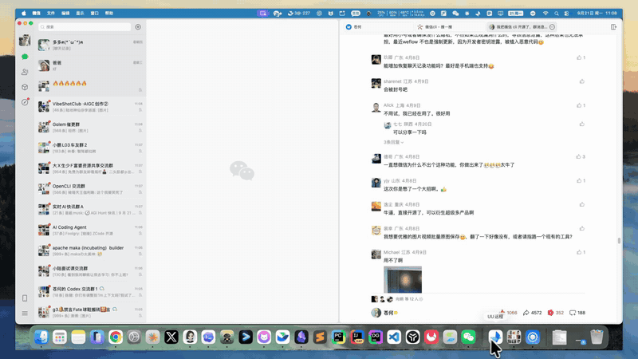
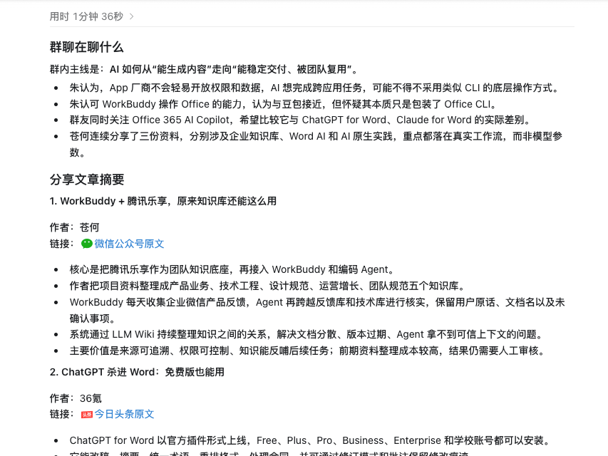
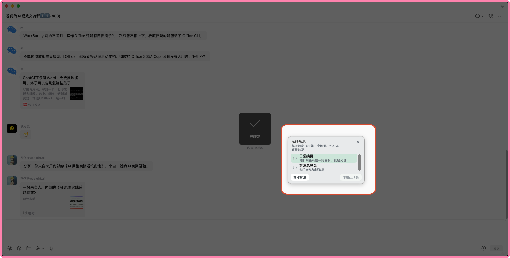
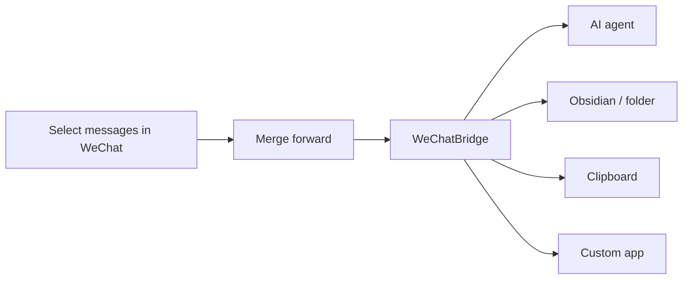

<div align="center">
  
  <h1>WeChatBridge (微信流)</h1>
  <p><strong>Hundreds of unread group messages? Select, forward, and hand them to AI for a summary—or save them to your knowledge base.</strong></p>
  <p>Pick Codex, Claude, Doubao, QwenWork, Obsidian, and more straight from WeChat's “Forward to other apps” menu. No database access, no injection into WeChat, fully local.</p>

  <p>
    <a href="#download"></a>
    <a href="#join-the-community"></a>
    <a href="https://github.com/freestylefly/WeChatBridge/stargazers"></a>
    <a href="LICENSE"></a>
  </p>

  <p>
    <a href="#download"><strong>Download</strong></a> ·
    <a href="#join-the-community"><strong>Community</strong></a> ·
    <a href="USAGE_EN.md">Usage guide</a> ·
    <a href="https://render.qmuse.pub/p/muse/2413870555736078">Website</a> ·
    <a href="README.md">简体中文</a>
  </p>

  
  <br />
  <sub>Select group messages → Forward to other apps → pick “Send to Codex” and a scene → the agent receives the conversation and starts summarizing</sub>
</div>

## What it does for you

<table>
  <tr>
    <th align="center" width="33%">Hand a group chat to AI</th>
    <th align="center" width="33%">Keep it in your knowledge base</th>
    <th align="center" width="33%">One scene per group</th>
  </tr>
  <tr>
    <td align="center"></td>
    <td align="center"></td>
    <td align="center"></td>
  </tr>
  <tr>
    <td><sub>Forward to Codex, Claude, Doubao, QwenWork, WorkBuddy, and more. The prompt is attached and the conversation pasted for you—press Return for a summary, to-dos, and minutes.</sub></td>
    <td><sub>Save it as an Obsidian note or Markdown in any folder, with images and attachments kept as they are and filed by chat name.</sub></td>
    <td><sub>Keep a prompt for each group, such as “Group summary” or “Daily digest”, and pick one when you forward. Skill packs let agents read the links and videos people share.</sub></td>
  </tr>
</table>

More than 100 messages? WeChat forwards at most 100 at a time, so use “Collect in WeChatBridge” to pick them in batches and send them all at once.

<div align="center">
  
  <br />
  <sub>Twelve built-in entries, plus any app you add as a custom destination</sub>
</div>

## Get started in three steps

1. **Install**: download from the Lanzou Cloud links below. On macOS, drag WeChatBridge into Applications.
2. **Turn on entries**: in “WeChatBridge → Settings → Entries”, enable the destinations you want, such as “Send to Codex” or “Save to Obsidian”.
3. **Forward**: in WeChat, select messages → “Merge forward” → “Forward to other apps” → choose a WeChatBridge entry.

Requires WeChat for macOS 4.1.13 or later. Full steps, permissions, and troubleshooting live in the [usage guide](USAGE_EN.md).

## Download

Free to download. All installers are distributed through Lanzou Cloud, and the extraction password is **`向明`** for both:

| Platform | Download | Password |
| --- | --- | --- |
| macOS 14+ (Apple Silicon and Intel) | [wwbsr.lanzout.com/b0umjur8h](https://wwbsr.lanzout.com/b0umjur8h) | `向明` |
| Windows | [wwbsr.lanzout.com/b0umjur4d](https://wwbsr.lanzout.com/b0umjur4d) | `向明` |

On macOS, open the DMG and drag WeChatBridge into Applications. On Windows, unzip the archive and follow the instructions inside. An iOS version is in development—join the group to hear about it first.

## Join the community

<table>
  <tr>
    <td width="300" align="center">
      
      <br />
      <sub>Scan with WeChat to join</sub>
    </td>
    <td>
      <strong>In the group you can:</strong>
      <ul>
        <li>Hear first about new releases and new platforms such as iOS</li>
        <li>Ask the developers directly when installing, finding an entry, or pasting doesn't work</li>
        <li>Pick up the scene prompts and skill packs other members use—faster than writing your own</li>
        <li>Request features: tell us which app you want your conversations sent to</li>
      </ul>
      If the QR code has expired, scan 苍何's WeChat under “About us” below and mention “WeChatBridge”.
    </td>
  </tr>
</table>

## Why WeChatBridge

Starting with WeChat 4.1.13 for macOS, you can select messages and “merge forward” them to third-party apps. WeChat exports a ZIP containing the text transcript, images, and videos—a good fit for AI agents and local knowledge bases.

But the system's “Forward to other apps” menu only lists apps that ship a Share Extension, and most AI tools don't. WeChatBridge adds that missing entry point, so one forward goes straight to your agent, Obsidian, the clipboard, or any app you choose.



## All features

<details>
<summary><strong>Highlights</strong></summary>

| Capability | Experience |
| --- | --- |
| Twelve native entries | Pick a destination in WeChat without opening the main app |
| AI agent hand-off | Activate the target app, attach a scene prompt, and paste the archive |
| Obsidian archiving | Create a Markdown note, retain the original ZIP, and organize it by chat name |
| Custom destinations | Add any macOS app; terminal-style apps can receive file paths only |
| Scenes and skills | Keep prompts per conversation and manage agent-compatible `SKILL.md` packages |
| Local history | Inspect delivery state, retry, copy, reveal files, and clean old batches |
| Safe fallback | Files remain on the clipboard when an app or permission is unavailable |
| Bilingual UI | Simplified Chinese and English throughout |

</details>

<details>
<summary><strong>Twelve built-in entries</strong></summary>

| Entry | Behavior |
| --- | --- |
| Send to Codex | Activate ChatGPT/Codex and paste the conversation archive |
| Send to Claude | Activate Claude and paste the conversation archive |
| Send to Doubao | Activate Doubao and paste the conversation archive |
| Send to QwenWork | Activate QwenWork and paste the conversation archive |
| Send to WorkBuddy | Activate WorkBuddy and paste the conversation archive |
| Send to WeSight | Activate WeSight and paste the conversation archive |
| Send to DeepSeek Harness | Activate DeepSeek Harness and paste the conversation archive |
| Save to Obsidian | Create a Markdown note and preserve the original attachment |
| Save to folder | Write Markdown and attachments to the selected folder; reveal files from the notification |
| Collect in WeChatBridge | Receive multiple original ZIPs, then choose a target and scene once |
| Copy to Clipboard | Keep the files ready for a manual paste |
| Send to Custom | Route the batch to an app from your own list |

When collecting in batches, select each batch in WeChat and share it to “Collect in WeChatBridge”. A floating bar shows the batches so far and where the last one started and ended; click “Finish and send” when you have them all. Original images and videos stay in the ZIPs, an unfinished collection can be resumed from History, and a failed send can be retried.

</details>

<details>
<summary><strong>More screenshots</strong></summary>

<table>
  <tr>
    <th align="center">WeChat forward menu</th>
    <th align="center">Destination switches</th>
  </tr>
  <tr>
    <td align="center"></td>
    <td align="center"></td>
  </tr>
  <tr>
    <th align="center">Scenes</th>
    <th align="center">Skill Center</th>
  </tr>
  <tr>
    <td align="center"></td>
    <td align="center"></td>
  </tr>
</table>

</details>

## Privacy by design

Your conversations only move around on your own computer:

- Conversation content only comes from files explicitly exported by WeChat.
- The app does not read WeChat databases, decrypt data, inject code, or modify WeChat.
- Archives, scenes, and history stay on your computer.
- Every Share Extension runs inside the macOS sandbox without network access.
- Screen Recording is used only to recognize the chat name in WeChat's title bar; images are processed in memory.
- Accessibility is used only to activate a destination and perform the paste action.

## About us

For project updates and tips, follow our WeChat Official Account or add us on WeChat:

<table>
  <tr>
    <th align="center">向明</th>
    <th align="center">苍何</th>
  </tr>
  <tr>
    <td align="center"></td>
    <td align="center"></td>
  </tr>
</table>

---

## For developers

### Build from source

Requires macOS 14+ and Xcode 16 or Command Line Tools with Swift 6 support.

```bash
git clone https://github.com/freestylefly/WeChatBridge.git
cd WeChatBridge/macos
swift test
CONFIG=release Scripts/make-app.sh
```

The app is assembled at `macos/dist/微信流.app`. Install it into the current user's Applications directory and register its Share Extensions with:

```bash
Scripts/install-dev-build.sh
```

Open “WeChatBridge → Settings → Entries” and enable the destinations you want. They can also be managed in “System Settings → General → Login Items & Extensions → Sharing.”

> [!TIP]
> Local builds prefer an Apple Development or Developer ID identity from your keychain. When no certificate is available, the build uses ad-hoc signing and macOS may ask you to grant Accessibility again.

### Development checks

```bash
# macOS (run from macos/)
cd macos
swift test                                    # Run tests
swift Scripts/check-localizations.swift       # Validate Chinese and English resources
Scripts/check-release-config.sh               # Signing / bundle ID / App Group checks
Scripts/dev-preview.sh                        # Build, install, and open a development copy

# Windows
dotnet test windows/WeChatBridge.Windows.sln -c Release
```

<details>
<summary><strong>Project layout</strong></summary>

```text
macos/                    # macOS SwiftPM package
├── Sources/              # App, core logic, and Share Extension
├── Resources/            # Plists, entitlements, and localizations
├── Scripts/              # Build, install, signing, and release tooling
└── Tests/                # Swift Testing / XCTest coverage
ios/                      # iOS app (in development), XcodeGen project reusing WeChatBridgeCore
windows/                  # Windows .NET WPF solution, Share Target, and tests
shared/                   # Agent logos, design assets, screenshots, demos, and skills
site/                     # Sparkle update feed and release notes
```

Swift Package Manager owns the macOS source layout and the Sparkle dependency. `macos/Scripts/make-app.sh` assembles the host executable and twelve Share Extensions into a complete `.app` bundle. For iOS see `ios/project.yml`; for Windows see `windows/AGENTS.md` and `windows/docs/README.zh-CN.md`.

</details>

### Contributing

Issues and pull requests are welcome:

1. Check [Issues](https://github.com/freestylefly/WeChatBridge/issues) for an existing discussion.
2. Fork the repository and create a focused branch from `main`.
3. Keep changes scoped and add tests for behavior changes.
4. Run `swift test` and the localization check before submitting.
5. Describe the motivation, verification, and any visual changes in the pull request.

Please report security issues privately through [GitHub Security Advisories](https://github.com/freestylefly/WeChatBridge/security/advisories/new). Avoid posting sensitive details in a public issue.

### Roadmap

- [x] Native merged-forward support from WeChat
- [x] Codex, Claude, Doubao, QwenWork, WorkBuddy, and WeSight
- [x] Local Obsidian archiving
- [x] Scene prompts and skill management
- [x] Universal 2 build, signing, and notarization pipeline
- [x] First public DMG release
- [x] Windows version
- [ ] iOS version
- [ ] Homebrew Cask
- [ ] More community scenes and skill packages

## License

WeChatBridge is released under the [MIT License](LICENSE).

## Acknowledgements

- [Dukou (渡口)](https://github.com/qzz0518/Dukou): WeChatBridge is built on this project.
- [Sparkle](https://github.com/sparkle-project/Sparkle) provides secure update delivery for the macOS app.
- Thanks to everyone who tested the app, shared feedback, and contributed code.

<div align="center">
  <br />
  <strong>If WeChatBridge saves you from scrolling through group chats, leave a ⭐️ Star so more people can find it.</strong>
  <br />
  <sub>Questions or ideas? <a href="#join-the-community">Come chat with us</a>.</sub>
</div>
