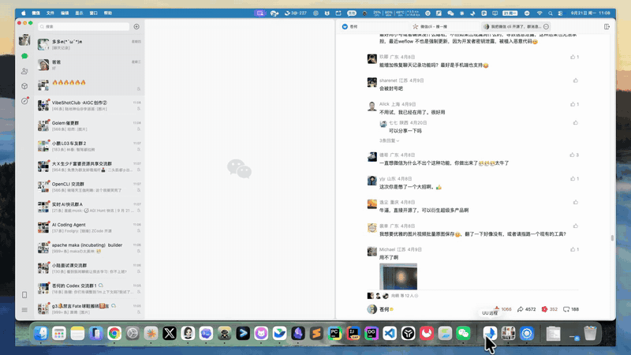
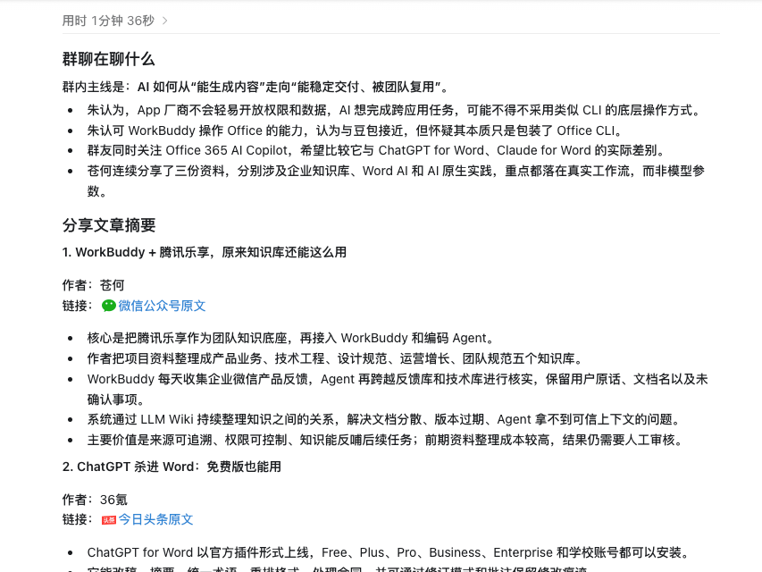
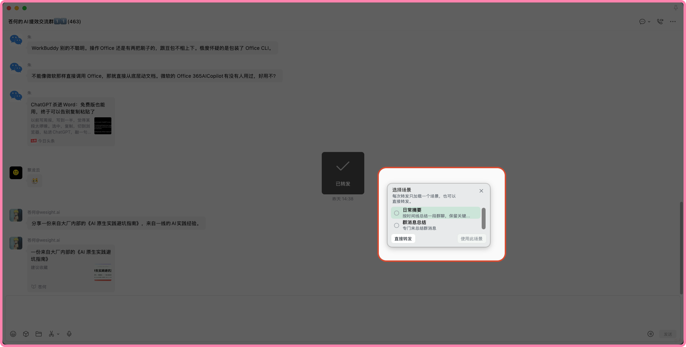
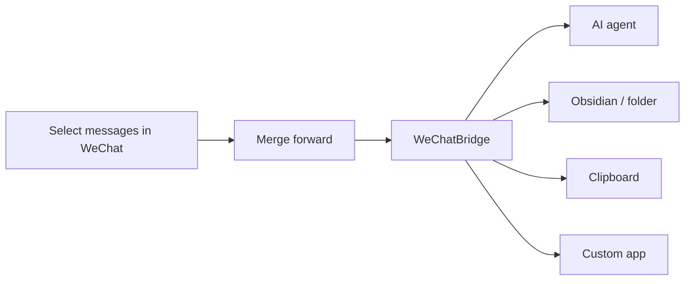
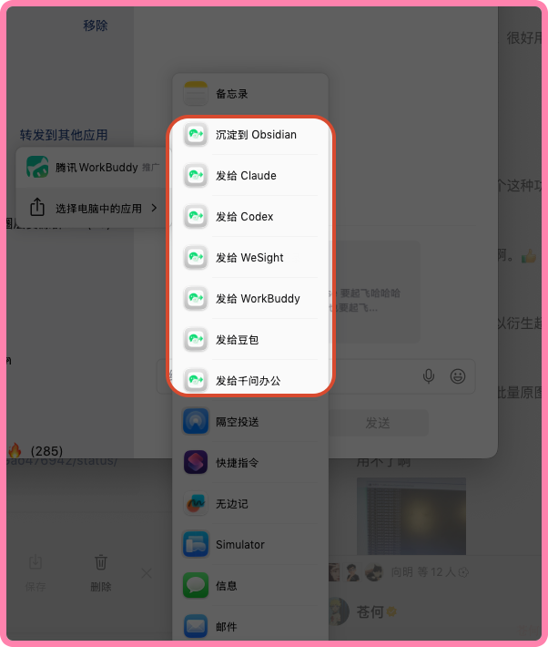
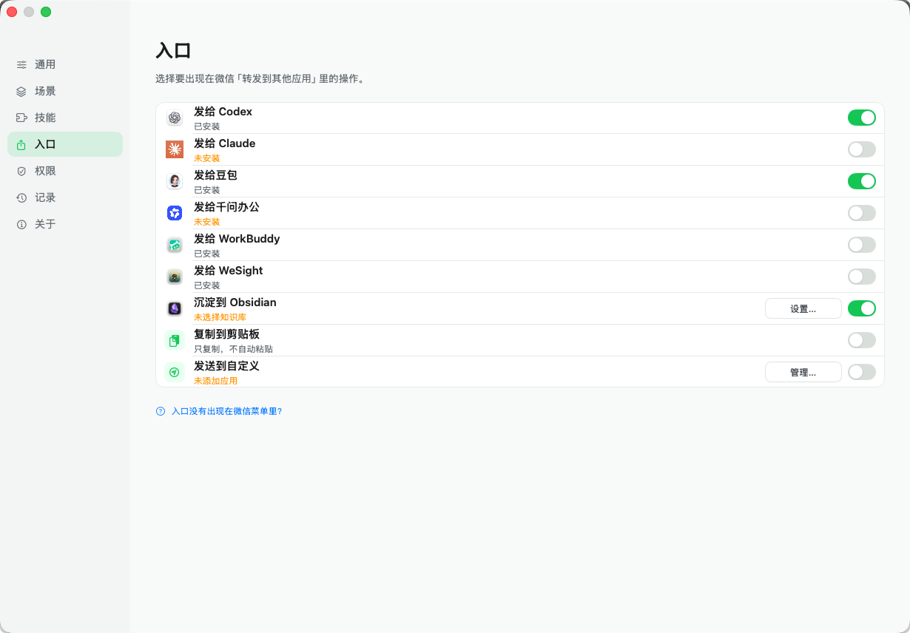
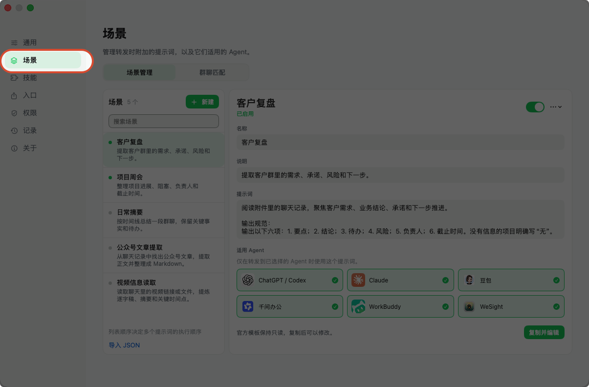
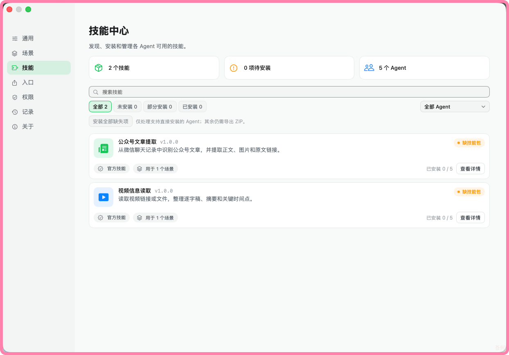

<div align="center">
  
  <h1>WeChatBridge (微信流)</h1>
  <p><strong>グループの未読メッセージが何百件も？ 選んで転送し、AI に要約を任せるか、ナレッジベースに保存しましょう。</strong></p>
  <p>WeChat の「Forward to other apps」メニューから、Codex、Claude、Doubao、QwenWork、Obsidian などを直接選べます。データベースへのアクセスも、WeChat へのインジェクションもなく、すべてローカルで動きます。</p>

  <p>
    <a href="#ダウンロード"></a>
    <a href="#コミュニティに参加"></a>
    <a href="https://github.com/freestylefly/WeChatBridge/stargazers"></a>
    <a href="LICENSE"></a>
  </p>

  <p>
    <a href="#ダウンロード"><strong>ダウンロード</strong></a> ·
    <a href="#コミュニティに参加"><strong>コミュニティ</strong></a> ·
    <a href="USAGE_EN.md">使い方ガイド</a> ·
    <a href="https://render.qmuse.pub/p/muse/2413870555736078">Web サイト</a> ·
    <a href="README.md">简体中文</a> ·
    <a href="README_EN.md">English</a>
  </p>

  
  <br />
  <sub>グループのメッセージを選ぶ → Forward to other apps → 「Send to Codex」とシーンを選ぶ → エージェントが会話を受け取って要約を始める</sub>
</div>

## できること

<table>
  <tr>
    <th align="center" width="33%">グループチャットを AI に任せる</th>
    <th align="center" width="33%">ナレッジベースに保存する</th>
    <th align="center" width="33%">グループごとにシーンを 1 つ</th>
  </tr>
  <tr>
    <td align="center"></td>
    <td align="center"></td>
    <td align="center"></td>
  </tr>
  <tr>
    <td><sub>Codex、Claude、Doubao、QwenWork、WorkBuddy などに転送できます。プロンプトが添えられ、会話も貼り付けられるので、Return キーを押すだけで要約、ToDo、議事録が得られます。</sub></td>
    <td><sub>Obsidian のノートとして、または任意のフォルダーに Markdown として保存できます。画像や添付ファイルはそのまま残り、チャット名ごとに整理されます。</sub></td>
    <td><sub>「Group summary」や「Daily digest」のように、グループごとにプロンプトを用意しておき、転送するときに選べます。スキルパックを使うと、エージェントがメンバーの共有したリンクや動画を読めるようになります。</sub></td>
  </tr>
</table>

100 件を超えるメッセージは？ WeChat は一度に最大 100 件までしか転送できないので、「Collect in WeChatBridge」を使って何回かに分けて選び、まとめて一度に送ってください。

<div align="center">
  
  <br />
  <sub>12 個の組み込みのエントリーに加え、カスタムの送り先として任意のアプリを追加できます</sub>
</div>

## 3 ステップで始める

1. **インストール**：下記の Lanzou Cloud のリンクからダウンロードします。macOS では、WeChatBridge を「アプリケーション」にドラッグします。
2. **エントリーを有効にする**：「WeChatBridge → Settings → Entries」で、「Send to Codex」や「Save to Obsidian」など、使いたい送り先を有効にします。
3. **転送する**：WeChat でメッセージを選び → 「Merge forward」 → 「Forward to other apps」 → WeChatBridge のエントリーを選びます。

macOS 版 WeChat 4.1.13 以降が必要です。詳しい手順、権限、トラブルシューティングは[使い方ガイド](USAGE_EN.md)にあります。

## ダウンロード

無料でダウンロードできます。インストーラーはすべて Lanzou Cloud で配布しており、展開用のパスワードはどちらも **`向明`** です：

| プラットフォーム | ダウンロード | パスワード |
| --- | --- | --- |
| macOS 14+（Apple Silicon と Intel） | [wwbsr.lanzout.com/b0umjur8h](https://wwbsr.lanzout.com/b0umjur8h) | `向明` |
| Windows | [wwbsr.lanzout.com/b0umjur4d](https://wwbsr.lanzout.com/b0umjur4d) | `向明` |

macOS では、DMG を開いて WeChatBridge を「アプリケーション」にドラッグします。Windows では、アーカイブを展開して中の手順に従ってください。iOS 版は開発中です。グループに参加すると、いち早く情報を受け取れます。

## コミュニティに参加

<table>
  <tr>
    <td width="300" align="center">
      
      <br />
      <sub>WeChat でスキャンして参加</sub>
    </td>
    <td>
      <strong>グループでは次のことができます：</strong>
      <ul>
        <li>新しいリリースや、iOS などの新しいプラットフォームについていち早く知る</li>
        <li>インストール、エントリーの検索、貼り付けがうまくいかないときに、開発者に直接質問する</li>
        <li>他のメンバーが使っているシーンのプロンプトやスキルパックを手に入れる（自分で書くより早いです）</li>
        <li>機能をリクエストする：会話をどのアプリに送りたいかを教えてください</li>
      </ul>
      QR コードの期限が切れている場合は、下の「私たちについて」にある苍何の WeChat をスキャンし、「WeChatBridge」と伝えてください。
    </td>
  </tr>
</table>

## WeChatBridge を作った理由

macOS 版 WeChat 4.1.13 から、メッセージを選んでサードパーティのアプリに「merge forward（まとめて転送）」できるようになりました。WeChat はテキストの記録、画像、動画を含む ZIP を書き出すので、AI エージェントやローカルのナレッジベースにぴったりです。

ところが、システムの「Forward to other apps」メニューに表示されるのは Share Extension を持つアプリだけで、ほとんどの AI ツールはそれを持っていません。WeChatBridge はその欠けている入口を補うので、1 回の転送で、エージェント、Obsidian、クリップボード、あるいは選んだ任意のアプリに直接届きます。



## すべての機能

<details>
<summary><strong>主な特長</strong></summary>

| 機能 | 体験 |
| --- | --- |
| 12 個のネイティブなエントリー | メインのアプリを開かずに、WeChat の中で送り先を選べる |
| AI エージェントへの引き渡し | 送り先のアプリを起動し、シーンのプロンプトを添えて、アーカイブを貼り付ける |
| Obsidian へのアーカイブ | Markdown のノートを作成し、元の ZIP を残して、チャット名ごとに整理する |
| カスタムの送り先 | 任意の macOS アプリを追加できる。ターミナル系のアプリはファイルパスだけを受け取れる |
| シーンとスキル | 会話ごとにプロンプトを保存し、エージェント互換の `SKILL.md` パッケージを管理する |
| ローカルの履歴 | 送信の状態を確認し、再試行、コピー、ファイルの表示、古いバッチの整理ができる |
| 安全なフォールバック | アプリや権限が使えないときは、ファイルをクリップボードに残す |
| 2 か国語の UI | 全体が簡体字中国語と英語に対応 |

</details>

<details>
<summary><strong>12 個の組み込みのエントリー</strong></summary>

| エントリー | 動作 |
| --- | --- |
| Send to Codex | ChatGPT/Codex を起動して会話のアーカイブを貼り付ける |
| Send to Claude | Claude を起動して会話のアーカイブを貼り付ける |
| Send to Doubao | Doubao を起動して会話のアーカイブを貼り付ける |
| Send to QwenWork | QwenWork を起動して会話のアーカイブを貼り付ける |
| Send to WorkBuddy | WorkBuddy を起動して会話のアーカイブを貼り付ける |
| Send to WeSight | WeSight を起動して会話のアーカイブを貼り付ける |
| Send to DeepSeek Harness | DeepSeek Harness を起動して会話のアーカイブを貼り付ける |
| Save to Obsidian | Markdown のノートを作成し、元の添付ファイルを残す |
| Save to folder | 選んだフォルダーに Markdown と添付ファイルを書き込み、通知からファイルを表示できる |
| Collect in WeChatBridge | 複数の元の ZIP を受け取り、送り先とシーンを一度だけ選ぶ |
| Copy to Clipboard | 手動で貼り付けられるようにファイルを用意しておく |
| Send to Custom | 自分のリストにあるアプリにバッチを送る |

何回かに分けて集めるときは、WeChat でバッチごとに選び、「Collect in WeChatBridge」に共有します。フローティングバーに、これまでのバッチと、最後のバッチがどこから始まりどこで終わったかが表示されます。すべて集まったら「Finish and send」をクリックします。元の画像と動画は ZIP の中に残り、途中までの収集は History から再開でき、送信に失敗しても再試行できます。

</details>

<details>
<summary><strong>その他のスクリーンショット</strong></summary>

<table>
  <tr>
    <th align="center">WeChat の転送メニュー</th>
    <th align="center">送り先のスイッチ</th>
  </tr>
  <tr>
    <td align="center"></td>
    <td align="center"></td>
  </tr>
  <tr>
    <th align="center">シーン</th>
    <th align="center">Skill Center</th>
  </tr>
  <tr>
    <td align="center"></td>
    <td align="center"></td>
  </tr>
</table>

</details>

## プライバシーを考えた設計

会話はあなた自身のコンピューターの中でしか移動しません：

- 会話の内容は、WeChat が明示的に書き出したファイルからしか取得しません。
- アプリは WeChat のデータベースを読んだり、データを復号したり、コードをインジェクションしたり、WeChat を改変したりしません。
- アーカイブ、シーン、履歴はコンピューターの中にとどまります。
- すべての Share Extension は、ネットワークにアクセスできない macOS のサンドボックス内で動きます。
- 画面収録は、WeChat のタイトルバーにあるチャット名を認識するためだけに使い、画像はメモリ内で処理します。
- アクセシビリティは、送り先を起動して貼り付けの操作を行うためだけに使います。

## 私たちについて

プロジェクトの最新情報やヒントは、WeChat 公式アカウントをフォローするか、WeChat で追加してください：

<table>
  <tr>
    <th align="center">向明</th>
    <th align="center">苍何</th>
  </tr>
  <tr>
    <td align="center"></td>
    <td align="center"></td>
  </tr>
</table>

---

## 開発者向け

### ソースからビルドする

macOS 14+ と、Swift 6 に対応した Xcode 16 または Command Line Tools が必要です。

```bash
git clone https://github.com/freestylefly/WeChatBridge.git
cd WeChatBridge/macos
swift test
CONFIG=release Scripts/make-app.sh
```

アプリは `macos/dist/微信流.app` に組み立てられます。現在のユーザーの「アプリケーション」ディレクトリにインストールし、Share Extension を登録するには、次を実行します：

```bash
Scripts/install-dev-build.sh
```

「WeChatBridge → Settings → Entries」を開き、使いたい送り先を有効にします。「システム設定 → 一般 → ログイン項目と機能拡張 → 共有」でも管理できます。

> [!TIP]
> ローカルでのビルドでは、キーチェーンにある Apple Development または Developer ID の ID を優先して使います。証明書がない場合はアドホック署名でビルドされ、macOS からアクセシビリティの許可をもう一度求められることがあります。

### 開発時のチェック

```bash
# macOS (run from macos/)
cd macos
swift test                                    # Run tests
swift Scripts/check-localizations.swift       # Validate Chinese and English resources
Scripts/check-release-config.sh               # Signing / bundle ID / App Group checks
Scripts/dev-preview.sh                        # Build, install, and open a development copy

# Windows
dotnet test windows/WeChatBridge.Windows.sln -c Release
```

<details>
<summary><strong>プロジェクトの構成</strong></summary>

```text
macos/                    # macOS SwiftPM package
├── Sources/              # App, core logic, and Share Extension
├── Resources/            # Plists, entitlements, and localizations
├── Scripts/              # Build, install, signing, and release tooling
└── Tests/                # Swift Testing / XCTest coverage
ios/                      # iOS app (in development), XcodeGen project reusing WeChatBridgeCore
windows/                  # Windows .NET WPF solution, Share Target, and tests
shared/                   # Agent logos, design assets, screenshots, demos, and skills
site/                     # Sparkle update feed and release notes
```

macOS のソースの構成と Sparkle の依存関係は Swift Package Manager で管理しています。`macos/Scripts/make-app.sh` は、ホストの実行ファイルと 12 個の Share Extension を組み立てて、完全な `.app` バンドルにします。iOS については `ios/project.yml` を、Windows については `windows/AGENTS.md` と `windows/docs/README.zh-CN.md` を参照してください。

</details>

### コントリビューション

Issue とプルリクエストを歓迎します：

1. 既存の議論がないか [Issues](https://github.com/freestylefly/WeChatBridge/issues) を確認してください。
2. リポジトリをフォークし、`main` から目的を絞ったブランチを作成してください。
3. 変更の範囲を絞り、挙動を変える場合はテストを追加してください。
4. 提出する前に `swift test` とローカライズのチェックを実行してください。
5. プルリクエストには、動機、検証の方法、見た目の変更があればその内容を書いてください。

セキュリティの問題は、[GitHub Security Advisories](https://github.com/freestylefly/WeChatBridge/security/advisories/new) から非公開で報告してください。公開の Issue に機密性のある詳細を書かないでください。

### ロードマップ

- [x] WeChat からのネイティブなまとめて転送への対応
- [x] Codex、Claude、Doubao、QwenWork、WorkBuddy、WeSight
- [x] Obsidian へのローカルなアーカイブ
- [x] シーンのプロンプトとスキルの管理
- [x] Universal 2 のビルド、署名、公証のパイプライン
- [x] 初めての DMG の一般公開
- [x] Windows 版
- [ ] iOS 版
- [ ] Homebrew Cask
- [ ] コミュニティのシーンとスキルパッケージの拡充

## ライセンス

WeChatBridge は [MIT License](LICENSE) のもとで公開されています。

## 謝辞

- [Dukou (渡口)](https://github.com/qzz0518/Dukou)：WeChatBridge はこのプロジェクトをもとに作られています。
- [Sparkle](https://github.com/sparkle-project/Sparkle) は、macOS アプリの安全な更新配信を提供しています。
- アプリをテストし、フィードバックを寄せ、コードを提供してくださったすべての皆さんに感謝します。

<div align="center">
  <br />
  <strong>WeChatBridge のおかげでグループチャットをスクロールせずに済んだなら、より多くの人が見つけられるよう ⭐️ Star を付けてください。</strong>
  <br />
  <sub>質問やアイデアがありますか？ <a href="#コミュニティに参加">私たちと話しましょう</a>。</sub>
</div>
