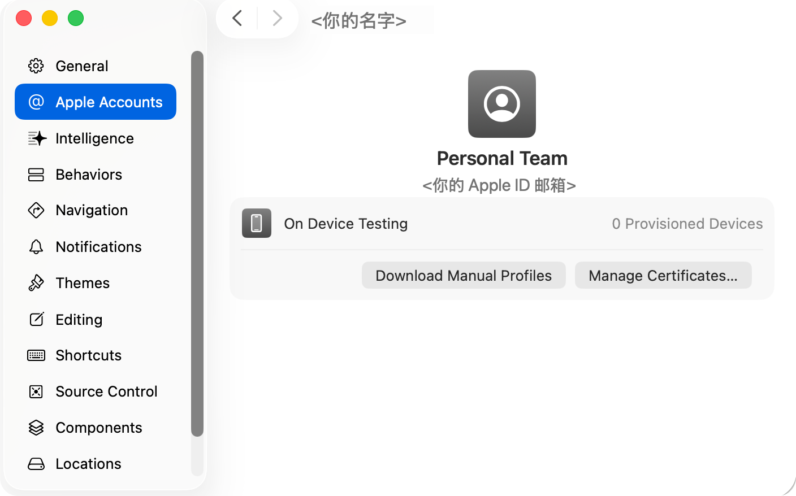
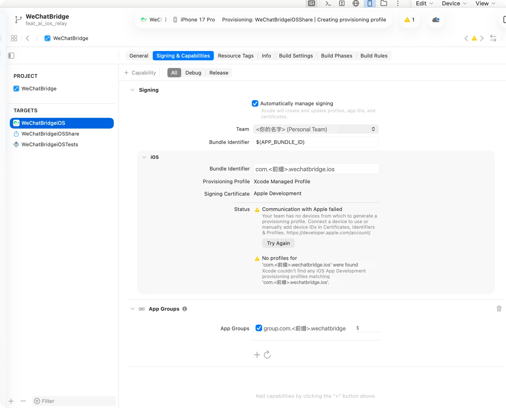
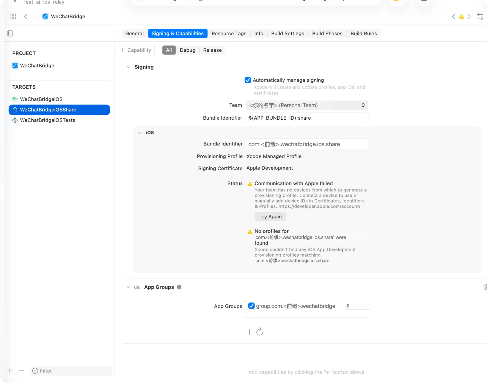
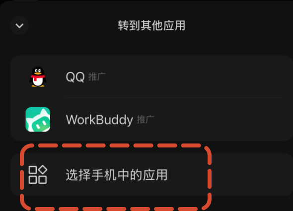

# 用免费 Apple ID 把微信流装到 iPhone

没有付费开发者账号也能在自己的 iPhone 上跑微信流，用于演示和真机验收（[验收记录](ios-验收记录.zh-CN.md) R1–R7）。代价是：签名 **7 天后过期**，过期后 App 打不开，要重新装一次。

已验证环境：Xcode 26，iPhone 16 Pro / iOS 26.5，免费 Personal Team。分享扩展和 App Group 在免费团队下都能用。

## 1. 在 Xcode 登录 Apple ID

Xcode → Settings → Apple Accounts → 左下角「+」→ Apple ID，登录后会出现一个 **Personal Team**。



## 2. 换成自己的 Bundle ID 和 App Group

仓库默认的 `com.xiangming.*` 属于付费团队，免费团队用不了，要换成自己的前缀（随便取，全球唯一即可，比如 Apple ID 的用户名）。

在 `ios/Config/` 下新建 `Signing.local.xcconfig`（已被 git 忽略，不会提交）：

```
// Local only (git-ignored): free Apple ID "Personal Team" for on-device demos.
DEVELOPMENT_TEAM = <你的 Team ID>
APP_BUNDLE_ID = com.<前缀>.wechatbridge.ios
APP_GROUP_ID = group.com.<前缀>.wechatbridge
```

Team ID 可以先空着，第 3 步在 Xcode 里选完团队后，从 Build Settings → Development Team 里看到 10 位 ID 再填回来；填了以后重新生成工程也不会丢。

三个值会一起带到：主 App 和扩展的 Bundle ID（扩展是 `$(APP_BUNDLE_ID).share`）、两个 entitlements 里的 App Group、Info.plist 的 `DKAppGroupIdentifier`。

然后在 `ios/` 下重新生成工程：

```bash
xcodegen generate -q
```

## 3. 两个 target 都选上 Personal Team

打开 `ios/WeChatBridge.xcodeproj`，分别选中 **WeChatBridgeiOS** 和 **WeChatBridgeiOSShare**，在 Signing & Capabilities 里：

- 勾选 Automatically manage signing
- Team 选「<你的名字> (Personal Team)」
- App Groups 下勾选 `group.com.<前缀>.wechatbridge`





截图里的「Communication with Apple failed / no devices」是正常的：免费团队必须先连上一台真机，Xcode 才能生成描述文件。做完第 4 步再点 Try Again，或者直接走第 5 步的命令行构建，警告会消失。

## 4. 连接并准备 iPhone

1. 用数据线连 Mac，手机上点「信任这台电脑」。
2. 如果 Xcode 里设备显示未配对，在 Mac 上执行一次配对，手机上确认：

   ```bash
   xcrun devicectl list devices
   ```

   ```bash
   xcrun devicectl manage pair --device <设备标识>
   ```

3. 打开开发者模式：设置 → 隐私与安全性 → 开发者模式 → 打开，按提示重启手机，重启后再确认一次。
   - 菜单里没有「开发者模式」时，先让 Xcode 往手机装一次（第 5 步），失败后这个开关就会出现。

## 5. 构建并安装

在 `ios/` 下执行。设备 ID 用 `xcrun xctrace list devices`（构建用）和 `xcrun devicectl list devices`（安装用）查，两者格式不同。

```bash
xcodebuild -project WeChatBridge.xcodeproj -scheme WeChatBridgeiOS -destination 'id=<xcodebuild 设备 ID>' -derivedDataPath build/Device -allowProvisioningUpdates -allowProvisioningDeviceRegistration build
```

```bash
xcrun devicectl device install app --device <devicectl 设备 ID> build/Device/Build/Products/Debug-iphoneos/WeChatBridgeiOS.app
```

```bash
xcrun devicectl device process launch --device <devicectl 设备 ID> com.<前缀>.wechatbridge.ios
```

也可以直接在 Xcode 里选中手机，点 Run。

## 6. 在手机上信任开发者

第一次启动会被系统拦下（「不受信任的开发者」）。到 设置 → 通用 → VPN 与设备管理 → 开发者 App 下点你的 Apple ID → 信任。之后 App 就能正常打开。

## 7. 从微信分享进来（R1）

1. 微信里多选聊天记录 → 转发 → 右上角「转到其他应用」→「选择手机中的应用」。
2. 在系统分享面板里选「微信流」。第一次找不到时，划到最右边点「更多」，把微信流打开并拖到前面。
3. 收据卡显示「已存入中转站」，回到微信流就能看到新卡片。



## 7 天过期之后

免费团队的描述文件 7 天有效。过期后 App 图标还在，但点开会闪退或提示无法验证。重新执行第 5 步的构建和安装即可，数据（中转站里的批次、设置）保留；不需要重新信任。演示前最好先重装一次。

## 常见问题

| 现象 | 处理 |
|---|---|
| Xcode 提示 Bundle ID 不可用 | 前缀被别人占了，换一个前缀，改 `Signing.local.xcconfig` 后重新 `xcodegen generate -q` |
| 构建报 Developer Mode disabled | 第 4 步第 3 条，打开开发者模式并重启 |
| 安装成功但启动被拒绝 | 第 6 步，信任开发者 |
| 设备在 Xcode 里显示 unpaired | 第 4 步第 2 条，`devicectl manage pair` |
| 免费团队最多同时 3 个 App | 删掉手机上别的自签 App 再装 |
