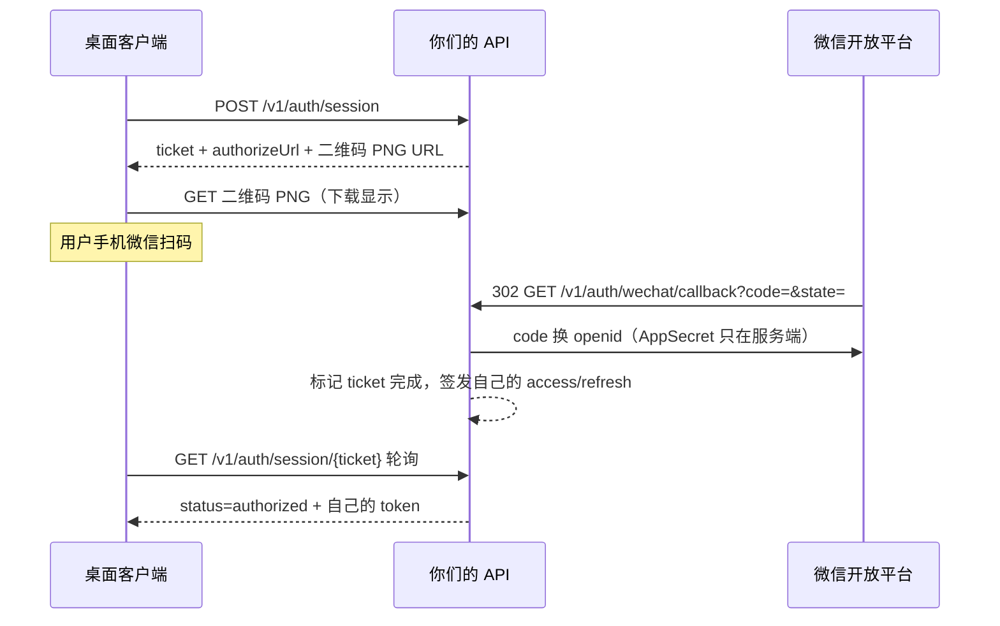
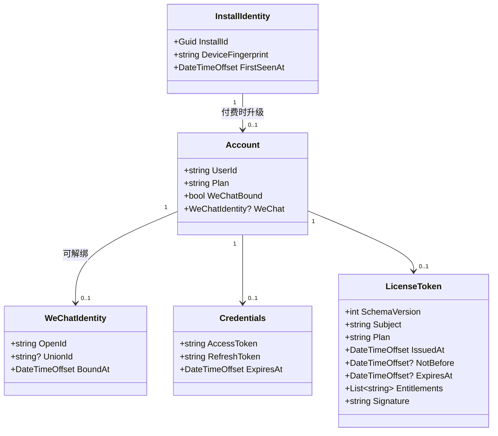

# Windows 端接入微信生态：认证与付费技术方案

> 状态：设计稿。Windows 平台先行，macOS 后续对齐。
> 前置条件：已具备营业执照、已完成微信开放平台开发者资质认证、**网站应用已创建并审核通过**。

## ⚠️ 章节有效性（2026-10-19 校准）

**兑换码已退役。** `internal/redeem` 与 `internal/billing` 两个包被有意删除，**不要照着实现下面标记为「已退役」的章节**——那会造出一个不存在的机制。退役原因与替代方案见本节。

实际替代兑换码的是**申请—确认**流，三个端点、**无支付网关**：

```
POST /v1/activation/request  {installId, anchorDigest, amountFen?}  → {requestId, status}
GET  /v1/activation/status                                          → {status, licenseId?}
GET  /v1/activation/licence                                         → {token, envelope}
```

即：已登录机器提交申请 → 卖家在管理后台**人工核对微信付款**并确认 → 机器轮询到确认后领取签名许可证。
实现在 `server/internal/activation/`，该包的包注释是这条链的权威说明。

| 章节 | 有效性 | 说明 |
| --- | --- | --- |
| §0–§2 | ✅ 现行 | 实测事实、客户端不直连微信、身份分两层 |
| §3.1–§3.3 | ❌ **已退役** | 兑换码端点 / 兑换码形态 / 兑换幂等键。兑换码不存在了，这三节的 Crockford Base32、烧码、90 天 TTL 全部作废。**代替它们的是上面的申请—确认流** |
| §3.4 起（二维码由服务端渲染） | ✅ 现行 | 服务端渲染仍成立，见 `server/internal/wechat/qr.go` |
| §4–§6 | ✅ 现行 | 数据模型、身份迁移、无感知登录边界（订阅版概念，仍有效） |
| §7.2 / §7.3 | ⚠️ **部分过期** | 「买断版怎么收费」的三个方案已定案为 B（一次性兑换窗口），但**兑换窗口本身已退役**。实际形态改为后台人工确认。「拆两个发行物」的结论仍成立 |
| §8 | ✅ 现行 | 微信扫码登录。已实现，见 `server/internal/auth/` 与 `server/internal/wechat/` |
| §9 | ❌ **已退役** | 微信支付 Native 扫码购买整章作废 |
| §10 | ✅ 现行 | 凭证、安全与授权层。**§10.1 的许可证签名与编码部分全部有效**，是客户端验签的依据 |
| §11 | ⚠️ **部分过期** | UI 接线大体有效；涉及支付的窗口与打包按新形态重做 |
| §12 轨道一 A3 | ❌ **已退役** | 「发放渠道」按方案 B 写的是兑换，改走后台确认 |
| §12 轨道二 B4 | ❌ **已退役** | 计费与订阅整阶段作废 |
| §13 风险登记 | ⚠️ 部分过期 | 与支付/兑换相关的条目不再适用；与签名、绑定、隐私相关的仍然适用 |
| §14 | ⚠️ 部分过期 | 「买断版怎么收费」的结论已被新形态取代 |
| §15.1–§15.4 | ✅ 现行 | 授权回调、ticket 生命周期、refresh 轮换、配额网关 |
| §15.5 | ❌ **已退役** | 微信支付 Native（含 notify_url 验签、APIv3、平台证书）全部作废 |
| §15.6 | ✅ 现行 | 数据隔离 |
| §16–§18 | ⚠️ 部分过期 | 文档分层、双发行物、交付物拆分。§16.4 的验证清单里与支付相关的条目需按新形态重写 |

**被删包影响到的客户端侧**：`POST /v1/license/redeem` 与 `/v1/billing/*` 都不存在了，
客户端若已按 §3.1 实现兑换窗，那部分需要改成申请—确认（`request → status → licence`）。

> 交叉引用：许可证 envelope 的跨端 wire 契约问题（服务端发 Unix 秒整数、C# 端声明
> `DateTimeOffset` 且无 converter）见 [LICENCE-ENVELOPE-WIRE-CONTRACT.zh-CN.md](LICENCE-ENVELOPE-WIRE-CONTRACT.zh-CN.md)，
> 回归夹具见 `shared/License/license-test-vectors.json`。

---

## 章目录

| 章 | 内容 | 谁该先读 |
| --- | --- | --- |
| [§0](#0-本方案已实测验证的技术事实) | **实测验证的技术事实**——本机编译验证过的结论，不要重新论证 | 所有人 |
| [§1](#1-为什么客户端不直连微信) | 为什么客户端不直连微信 | 所有人 |
| [§2](#2-身份分两层微信只占一层) | 身份分两层，微信只占一层 | 所有人 |
| [§3](#3-api-契约客户端--服务端) | API 契约（客户端 ↔ 服务端） | 前后端 |
| [§4](#4-核心数据模型) | 核心数据模型 | 后端 |
| [§5](#5-付费时的身份断层必须内置迁移) | **付费时的身份断层**——最易漏、也最易引发付费用户投诉 | 后端 |
| [§6](#6-无感知登录的能力边界) | 无感知登录的能力边界 | 产品 |
| [§7](#7-两种产品形态) | **两种产品形态**——买断版与订阅版，全文最重要的前提 | **所有人，先读这个** |
| [§8](#8-认证模块规格微信扫码登录) | 认证模块规格 | 客户端 |
| [§9](#9-付费模块规格微信支付-native-扫码) | 付费模块规格 | 客户端 |
| [§10](#10-凭证安全与授权层) | **凭证、安全与授权层**——风险最高的一章 | 客户端 + 后端 |
| [§11](#11-ui-接线与打包) | UI 接线与打包 | 客户端 |
| [§12](#12-分阶段落地路线) | 分阶段落地路线 | 所有人 |
| [§13](#13-风险登记) · [§14](#14-决策记录与未决事项) | 风险登记 · **决策记录与未决事项** | 产品 |
| [§15](#15-服务端规格本仓库之外但方案成立的前提) | 服务端规格 | 后端 |
| [§16](#16-两个产品的文档分层) | 两个产品的文档分层 | 文档 |
| [§17](#17-并行勘察的冲突裁决) | **并行勘察的冲突裁决**——与前文冲突时以此为准 | 所有人 |
| [§18](#18-交付物拆分73-的工程实现) | 交付物拆分（§7.3 的工程实现） | 构建 / 发布 |

**只读 §0、§7 和前四章就能理解整个方案**：买断与订阅是两个独立产品；客户端从不直连微信；二维码由服务端渲染；微信只做身份锚定；访问凭证与配额全归自己。后面各章是这几句的具体展开。

---

## 目录
## 0. 本方案已实测验证的技术事实

这些结论不是推测，是在本机 .NET 10.0.402 SDK 上编译验证过的，后续实现请直接采信，不要重新论证。

| 验证项 | 结果 | 对设计的影响 |
| --- | --- | --- |
| `ProtectedData` 在纯 `net10.0` 项目（`WeChatBridge.Windows.Core` 的目标框架） | ❌ `CS0103` 编译失败 | **DPAPI 加密不能放在 Core 层** |
| `ProtectedData` 在 `net10.0-windows10.0.19041.0` + `UseWPF`（`WeChatBridge.Windows` / `WeChatBridge.ShareTarget`） | ✅ 无需任何 NuGet 包 | 凭证加密落在 WPF 层，维持运行时零依赖 |
| `System.Security.Cryptography.Ed25519` 在 .NET 10 BCL | ❌ 类型不存在 | 许可证签名算法改用 **ECDSA P-256 + SHA-256** |
| ECDSA P-256 签名/验签 + `ExportSubjectPublicKeyInfo` / `ImportSubjectPublicKeyInfo` 往返 | ✅ 在 `Nullable=enable` + `TreatWarningsAsErrors=true` 下 0 警告 0 错误 | 离线许可证校验方案成立 |

**推论：Core 层与 WPF 层的边界必须重新划一道。** Core（`net10.0`，无 WPF 依赖、可测试）承载 CloudClient、契约类型、状态机、许可证验签逻辑；WPF 层承载 DPAPI 加密、窗口、二维码显示。Core 通过接口向 WPF 层索取一个"机密存储"能力，测试时注入内存实现。

---

## 1. 为什么客户端不直连微信

授权回调域在开放平台配置，**只能是已备案的公网 HTTPS 域名，不支持 `127.0.0.1`、不支持带端口、不支持 IP**。这意味着微信的 302 回调必然落在服务端公网地址上，桌面端无论如何都拿不到那个 `code`。

因此架构上只有一个形态是可行的：客户端只与自己的后端对话，微信的一切交互都在服务端完成。



直接后果：

- `AppID` / `AppSecret` **只存在于服务端**，客户端代码里永远不出现。
- 微信的 `access_token` **不进入客户端的鉴权链路**。客户端拿的是你们自己签发的 token，它才有 `userId`、配额和吊销能力。
- 两层身份必须分离，见下节。

---

## 2. 身份分两层，微信只占一层

这是整个方案里最容易做错的地方。

| 层 | 负责方 | 产物 | 生命周期 |
| --- | --- | --- | --- |
| **身份锚定** | 微信（qrconnect 网站应用） | `openid` / `unionid` / 昵称 / 头像 | 一次扫码确认，长期有效 |
| **访问凭证** | 你们自己的后端 | `accessToken` / `refreshToken` | access 1h，refresh 30d，轮换 |
| **付费权益** | 你们自己的后端 | 签名 `LicenseToken` | 长期，离线可验 |

微信身份在本地是**一个可绑定、可解绑的字段**，不是主键。用户表主键永远是你们自己的 `userId`。

理由：`openid` 在网站应用、小程序、服务号下各是各的，将来若增加入口或出移动端，只有同一开放平台下的 `unionid` 能打通。把账号体系的主键押在它上面，等于给未来的自己埋一次数据迁移。

---

## 3. API 契约（客户端 ↔ 服务端）

以下是客户端唯一需要知道的东西。服务端实现不在本仓库。

```jsonc
// ── 认证 ────────────────────────────────────────────
POST   /v1/auth/session            -> { ticket, authorizeUrl, qrImageUrl, expiresAt }
GET    /v1/auth/session/{ticket}   -> { status, accessToken?, refreshToken?, expiresAt?, account? }
POST   /v1/auth/refresh            -> { status, accessToken, refreshToken, expiresAt, account? }
DELETE /v1/auth/session            -> 204

// ── 账号与配额 ───────────────────────────────────────
GET    /v1/account                 -> AccountDto
GET    /v1/quota                   -> { used, limit, resetAt }

// ── 计费 ─────────────────────────────────────────────
POST   /v1/billing/orders                    -> { orderId, qrImageUrl, amount, currency, expiresAt }
GET    /v1/billing/orders/{orderId}          -> { orderId, status, paidAt?, licenseKey? }
POST   /v1/billing/orders/{orderId}/redeem   -> { licenseToken }

// ── 许可证兑换 ──────────────────────────────────────
// 买断版专用。烧掉一个一次性兑换码，换一张签名许可证。没有账号、没有凭据。
POST   /v1/license/redeem  { redeemCode, installId, deviceDigest, requestId }
                             -> 201 { status:"redeemed",        licenseToken, licenseId, redeemedAt }
                             -> 200 { status:"alreadyRedeemed", licenseToken, licenseId, redeemedAt }
```

`status` 枚举：

- 认证：`pending` → `authorized` / `expired` / `rejected`
- 订单：`pending` → `paid` / `closed` / `refunded`

### 3.1 兑换端点为什么不是「带 licenseKey 换 license」

**早期版本这里写的是 `POST /v1/license/activate { licenseKey }`。那个形态有四个致命面：**

1. **它把一个可复用的长期凭据变成了永久权益的铸造权。** 只要端点是"任意 licenseKey → 任意 licenseToken"，那么**泄露一次 licenseKey 就等于永久无限签发**。而兑换凭证几乎必然经过邮件、订单网页、客服对话——这三处都会截图、会转发、会进聊天记录。长期凭据不该是铸造权。
2. **重放不可判定。** "同一个码在另一台机器上兑过"和"用户在两台机器上都兑过"在这个形态下返回完全相同的东西。买断版是**设备绑定**的，第二种必须被拒绝、第一种必须能恢复——这需要服务端状态，而这个形态的服务端只需要无状态校验。
3. **没有幂等语义。** "响应在传输中丢了"这个场景无法恢复：客户端不知道成没成，重试就再铸一张，服务端也判断不了该不该再铸。
4. **它没有"兑换"这个动作。** 兑换的商业含义是烧掉一个一次性凭证。没有烧码，就没有"已使用"，也就没有可对外解释的账。

改成 `(一次性兑换码, 幂等键)` 后四条全部消失。

**核心不变式：一个兑换码 ⇒ 至多一个 `(code, installId)` 对 ⇒ 至多一张许可证。** 三层机制共同保证：

| 层 | 机制 | 防什么 |
| --- | --- | --- |
| ① 烧码 | 条件 UPDATE `WHERE redeemed_at IS NULL`，与写 `install_id` 同事务 | 并发双发 |
| ② 签发对象 | `Subject` 由服务端从 `licenseId` 派生，**绝不由请求体决定** | 一个码给 100 台机器签 100 张 |
| ③ 幂等表 | `(requestId) → 原信封字节`，**存原文字节而非重新签名** | 重试重复发证 |

> 第 ③ 层有个容易做错的地方：ECDSA 每次签名的随机 `k` 不同，**重新签产出的字节与原来的不同**。客户端验签都过，但一旦将来有任何一处对许可证做了哈希缓存或去重，行为就会分叉。**必须存原文字节**，不要只存 `licenseId` 然后重新签。

### 3.2 「成功但响应在传输中丢了」——整个流程里最容易做错的一处

现象：服务端烧码、签发、写了幂等表，200 响应体在路上被丢掉（超时、连接重置、拔网线、合盖）。**客户端不知道成没成。**

如果只是让用户再点一次"重试"，那么服务端因为码已烧会返回 409「此兑换码已在另一台设备上使用」——**而他明明就在这台机器上**。这是这个产品里最容易引发"我付了钱，你说我在撒谎"的一次错误文案。

**解法：把幂等键持久化，让重试变成"问"而不是"再来一次"。**

客户端在**第一次发请求之前**就落盘一个 pending 记录（含 `codeDigest` 与 `requestId`，注意**不存码本身**——这张文件在便携版上就是 U 盘上的明文）。之后任何一次重试都用同一个 `requestId`：

| 服务端实际状态 | 同一 `requestId` 重试的结果 | 用户看到 |
| --- | --- | --- |
| 从未收到过请求 | `201 redeemed` | 成功 |
| 已烧码，本进程重放 | `200 alreadyRedeemed` + **原信封字节** | 成功 |
| 已烧码，另一个 `requestId` | `409` | 已在别处使用 + 联系客服 |

第二行就是全部魔法：**服务端在返回 409 之前先查幂等表，查到就把原信封原样吐回来。**

用户为什么不会被卡住：窗口内的「重试」按钮立刻解决（90% 的场景）；关掉窗口也不丢，下次启动出现恢复横幅——**横幅不自动重试**，因为"用户没做任何事、程序自己发了个网络请求"与"兑换完成后不再联网"的承诺在感知上是拧的。

**唯一的不可自助恢复**：用户清了配置、pending 没了、码已烧。这条**如实告知**并转客服，不要试图用任何客户端手段绕过。

### 3.3 兑换码形态

```
WCB-7K3M9-XQ2H4-TB6PW-N5R2C
│    └── 20 字符 Crockford Base32 ──┘
└── 固定前缀，人眼可辨来源
```

- **熵**：20 个 Base32 字符 ≈ 100 bit，穷举不可行。可预测性不是这个设计的风险——**真正的风险是渠道泄露**，靠烧码与 90 天窗口应对。
- **字符集**：Crockford Base32 剔除 `I L O U`，人工誊抄错误率最低。零依赖：映射规则只有几条手写 `switch`。
- **分组**：4 组 × 5。便于人口述与客服核对。
- **无校验位**：走 HTTPS，校验位只防打字错误、不防攻击者，却给服务端多一条能出 bug 的分支。防打字错误的正解是 UI 提供「从剪贴板粘贴」。

> **归一化表是契约的一部分**，服务端与客户端必须共用同一张反混淆表。不一致的症状是"所有码都无效"，且没有任何签名异常可查——与 §10.2 的规范化 payload 一样，必须进共享测试向量。

**有效期 90 天，管理端可一键延长。** 这是产品与安全的真实权衡，写清楚以便将来复核：短 TTL 唯一能防的是"码在买家用到之前被别人拿走"，但买断版没有账号、服务端区分不了买家与拿到邮件的人；短 TTL 造成的后果是**已付费用户无法激活**，与 §10.11 把"重装系统后 Pro 失效"列为头号风险是同一量级。90 天覆盖了邮件延迟、订单页被收藏三个月后才打开、以及人工渠道的排队。

> 顺带解决了 §14 那条未决事项的一半：**买断版的换机自助解绑只能靠兑换码**——客服作废旧码、生成新码。这是兑换码必须有管理端（生成 / 延长 / 作废）的又一理由，也是 90 天 TTL 必须可延长的原因。人工渠道也走服务端生成，客服看不到也不能修改码本身。

### 二维码由服务端渲染

**客户端不引入二维码库。** 服务端把授权链接 / `code_url` 渲染成 PNG，客户端只 `GetByteArrayAsync` 拿字节流显示。

这条约束是为了保住仓库现状：`WeChatBridge.Windows.csproj` 目前**零 `PackageReference`**，而自绘二维码要写几百行图形代码、且在高分屏上极易糊。二维码渲染是一次性的、服务端可控的，扔在服务端最省事。

---

## 4. 核心数据模型



`InstallIdentity` 是无感知身份：首次启动生成 GUID，用户什么都不知道。付费时它被"升级"成 `Account`——**这一步的数据迁移是本方案里最容易漏、也最容易引发付费用户投诉的地方**，见下节。

---

## 5. 付费时的身份断层：必须内置迁移

用户在 A 电脑上无感知用了三个月，积累了一批云端数据。此时决定付费，扫码付款。

**付钱的那个微信号，和他积累数据时挂着的 `installId`，是没有任何服务端证据可以关联的两样东西。**

如果直接建一个新账号，他立刻会遇到"我付了钱，我之前的数据呢"。所以支付完成后的动作**不是**"创建账号"，而是"把 `installId` 的历史数据归到新账号下"：

```
支付成功 → 用微信身份换 account → 建立 Account
         → 把该 InstallIdentity 名下的 Documents / Tasks / 历史记录外键改写
         → 删除或标记旧的 InstallIdentity
```

数据模型上就是一次外键 UPDATE，不动表结构。但**必须写**，不能指望以后再补。

---

## 6. 无感知登录的能力边界

"无感知"能覆盖的是**设备身份**，不是**微信身份**。

微信没有提供任何读取"本机当前登录了哪个微信号"的接口。可选的两条路都不可接受：

- 读微信本地数据库 —— 数据库加密，要 key 就得逆向/注入进程。这正是 `README.md`「隐私设计」里"不读取微信数据库，不解密、不注入、不修改微信进程"的红线。
- 读 WorkBuddy 的登录凭据 —— 第三方私有数据，无合法接口。

所以：安装身份零摩擦，微信身份必须一次显式扫码。二者不是同一个东西，文档和 UI 上不要混称"登录"。

**边界提醒：** `installId` 天然跨不了设备。用户换电脑，无感知身份就没了。如果将来做多设备云同步，账号迟早必须存在——无感知买到的只是"第一天不用账号"，不是"永远不要账号"。

---

## 7. 两种产品形态

**这是本方案最重要的前提，它决定了后面所有章节怎么读。** 存在两个产品，不是同一个产品的两档配置：

| | **买断版** | **订阅版** |
| --- | --- | --- |
| 网络 | **不联网**，二进制层面就没有网络出口 | 联网 |
| 聊天归档本身 | 不上传 | 不上传 |
| 用户主动交给云端的文件 | 不适用（无云端能力） | **会上传，且必须逐次显式确认** |
| 身份 | 无账号 | 微信扫码登录 |
| 权益载体 | 签名许可证，`Exp = null` 永久 | 签名许可证，`Exp` 为短期，联网续签 |
| 绑定对象 | 设备 | 账号（受设备数上限约束） |
| 云端能力 | 无 | PDF 深度解析、Hermes 任务编排 |
| 现有文档 | **口径完全成立，不需要改** | 需要自己的文档 |

**买断版现有那些承诺——"完全本地""不上传""不提供云端同步"——全部继续成立**，因为它确实不联网。本方案讨论的认证、支付、云端能力**只属于订阅版**。

### 7.0 订阅版的"上传"必须说清楚，否则会写成一句谎话

订阅版的云端能力（PDF 深度解析、Hermes 任务编排）**本来就需要把用户内容发到服务端**——"用后台解析速度快"这个需求本身就在描述这件事。所以订阅版的边界不是"不上传"，而是：

| 内容 | 订阅版行为 |
| --- | --- |
| 聊天 ZIP 原件、归档 Markdown、场景配置、技能库、本地历史、设置 | **永远不上传** |
| 用户主动选择交给云端解析的 PDF | 上传 |
| 用户主动提交给大模型的任务内容 | 上传 |

**这条界线要同时落到交互和文档上**：

1. **逐次显式确认**，不能默认全传。用户点「深度解析」时，弹窗要列出**具体是哪些文件**、传到哪里、留存多久。
2. **本地优先的分级**：能本地解析的先本地解析，只把本地处理不了的、或用户主动点名要云端精度的交给服务端。**不要因为"有云端能力"就默认走云端。**
3. **留存期限要明确**：服务端保存用户文件多久、什么时候删。这会进入订阅版的隐私说明（§16.2）。

> 写"两版都不上传聊天内容"是错的——PDF 可能就是从聊天记录里导出的。这句话听起来很漂亮，但用户认真想一遍就会发现它站不住。**承诺的可信度来自它经得起最坏情况的追问，而不是来自它听起来有多好听。**

因此 §16 的性质也随之改变：它不是"承诺失效后的补救清单"，而是**两个产品各自的文档分层**。

### 7.1 便携版归买断形态

便携版是免费的本地转发工具，属于零网络形态。这比 §10.4 的结论有了更强的理由——**它不是"买断版的 Pro"，它就是买断形态的免费档**。便携版因此：

- 不提供登录（本来就不属于订阅形态）
- 不发放许可证（没有可验证的 Pro 权益可发）
- 不含任何网络代码路径

### 7.2 买断版怎么收费——需要你决策

**这是严格零网络承诺下最棘手的问题。** 许可证必须由服务端私钥签发，但买断版不能联网。三条路：

| 方案 | 买断版联网吗 | 用户体验 | 承诺强度 | |
| --- | --- | --- | --- | --- |
| **A · 粘贴激活码** | 全程零网络 | 在别处购买拿到激活码，粘贴进买断版 | **最强**，可审计 | 退路 |
| **B · 一次性兑换窗口** ✓ | 仅用户主动兑换时联网一次 | 点"激活"，扫一次码，之后永久离线 | 中等，措辞要精确 | **已选** |
| **C · 离线签发** | 不可能 | —— | 不可行（私钥不能进客户端） | 排除 |

**已决定采用 B。** 理由是它在体验与可信度之间取到了实际的最优点：

- A 的激活码流程对买断用户是真实的摩擦（要人工输入长串、输错没提示），而买断用户往往是最在意"简单直接"的那群人；
- B 兑现的承诺同样可以被验证和审计：**兑换完成之后，程序不再发起任何网络请求**——这一点可以写进隐私文档，也可以真的去测；
- B 的兑换端点只做一件事（用一次性 ticket 换签名许可证），不含任何会话、配额、云端能力的代码。

选定 B 后，隐私文档的措辞**必须**是精确的那一版，不能是"基本不联网"：

> 除兑换 Pro 许可证外不联网；兑换完成后不再发起任何网络请求。

这句话是可验证的（兑换后确实没有任何网络调用），也是可被审计的。模糊的措辞会毁掉一个本来很硬的承诺。

> 选 A 的路径仍然记录在这里，因为如果兑换端点的可用性成为问题（服务器挂了用户就换不了机），A 是零依赖的退路。**但默认走 B。**

### 7.3 为什么要做成两个发行物（已决定）

如果买断版二进制里含有完整的联网代码、只是运行时关闭，那么"不联网"就只是一个可以被打开的开关——用户改一个配置、改一个补丁，它就不成立了。**一个可以被单方面推翻的承诺，不是承诺。**

所以**已决定拆成两个独立发行物**：

- **买断版构建不包含 `Cloud/` 与 `Billing/` 目录**，只保留许可证校验、安装身份，以及一个极小的兑换路径（方案 B）；
- **MSIX 清单分两份**：买断版不声明 `internetClient`，订阅版声明；
- **版本号分开**（§16.2）——两版是不同产品，共用一个版本号会让用户和客服都判断不出某个包是哪种形态；
- 两个发行物共用同一套 `shared/` 资产与许可证格式，差异只在编译产物。

这样买断版的"不上传"是**结构性事实**，不是一条需要维护的纪律。

> 便携版只从**买断版**构建——它是买断形态的免费档。

---

## 8. 认证模块规格（微信扫码登录）

### 8.1 文件清单

Core 层（`windows/src/WeChatBridge.Windows.Core/Cloud/`）——判据只有一条：目标框架是 `net10.0`，可被同为 `net10.0` 的 `WeChatBridge.Windows.Tests` 直接引用。整个扫码流程的状态机、轮询、HTTP、错误映射没有一处需要 `System.Windows`。

| 文件 | 职责 |
| --- | --- |
| `Cloud/CloudContracts.cs` | 传输模型与 `AuthSessionStatusConverter`。唯一新增 converter 的注册点 |
| `Cloud/CloudException.cs` | `CloudErrorKind` 枚举 + 单一异常类型，形状照 `Archive/WeChatReadError.cs` |
| `Cloud/CloudClient.cs` | `CloudEndpoint` + `HttpClient` 单例 + 请求方法 + 状态码映射 |
| `Cloud/CloudEnvironment.cs` | 时序 seam（`Now` / `DelayAsync`），照 `DeliveryEnvironment` |
| `Cloud/AuthSessionState.cs` | 客户端状态机，纯数据零 IO |
| `Cloud/WeChatQrLoginService.cs` | 编排：创建会话 → 下载 PNG → 轮询到终态。唯一含轮询循环的文件 |
| `Cloud/SecretStore.cs` | 机密存取抽象（见 §10） |

WPF 层：

| 文件 | 职责 |
| --- | --- |
| `CloudQr/QrLoginWindow.xaml(.cs)` | 扫码对话框；持有 `CancellationTokenSource`，`Closed` 即取消 |
| `CloudQr/QrImageLoader.cs` | PNG 字节 → 冻结的 `BitmapSource`，后台线程解码 |
| `CloudQr/DpapiSecretStore.cs` | DPAPI 实现（**必须在此层**，见 §0 的实测结论） |
| `CloudQr/CloudLoginController.cs` | 账号态持有者。刻意不含 WPF 类型，故可 `<Compile Include>` 链接进测试工程 |

两个工程都是 SDK 风格，新 `.cs` 自动包含，**csproj 一行不改**。

### 8.2 序列化注册（唯一一处改动 `InboxModels.cs`）

`BatchManifest.JsonOptions` 的 converter 集合中，先出现的胜过 `[JsonConverter]` 属性，必须排在 `JsonStringEnumConverter` 之前（`InboxModels.cs` 注释明写）：

```csharp
Converters =
{
    new UtcIso8601Converter(),
    new ShareActionConverter(),
    new BatchOutcomeKindConverter(),
    new AgentIdConverter(),
    new CollectionStatusConverter(),
    new AuthSessionStatusConverter(),   // ← 新增，必须在下一行之前
    new JsonStringEnumConverter()
}
```

**时间戳硬要求**：服务端 `expiresAt` 必须发 `yyyy-MM-ddTHH:mm:ssZ`。`UtcIso8601Converter` 是既有契约（并已被 `ManifestContractTests.ManifestTimestampIsIso8601UtcWithZuluSuffix` 验证），不要发 `+08:00` 或裸时间戳。

`AuthSessionStatus` 保留 `Unknown` 成员而不是让未知值抛异常——服务端新增一个状态词不该把用户正在扫的二维码变成错误弹窗，轮询继续等即可。

### 8.3 轮询：手写循环，不用 `PeriodicTimer`

四条理由，按分量排序：

1. **仓库已有这个形状**——`Delivery/WindowsTargetResolver.cs` 就是 `deadline + while + Task.Delay(interval, ct)`。用 `PeriodicTimer` 会在同一个库里并存两种轮询写法。
2. **超时用服务端给的 `expiresAt` 判**，而非本地计时器。两份"二维码有效期"定义会漂移，而错的那份会把还能用的码判成过期。
3. **瞬时错误需要 `continue` 跳过本轮 delay 立即重试**，`PeriodicTimer` 的节拍不可跳过。
4. `CloudEnvironment.DelayAsync` 已是本仓库的 seam，`PeriodicTimer` 无法被同一套测试替换。

| 参数 | 值 | 理由 |
| --- | --- | --- |
| 快轮询间隔 | 2s | 用户掏手机的那 20 秒里延迟要在秒级 |
| 慢轮询间隔 | 5s | 6 次快轮询（12 秒）后用户显然不是马上扫，减少后端 QPS |
| 整体超时 | **不设本地超时**，用 `ticket.ExpiresAt` | 服务端权威值 |
| 单请求超时 | 20s | 大于轮询间隔，避免把自己的请求掐掉 |
| 连续传输失败上限 | 5 次 | 最坏 25 秒才放弃；笔记本睡醒一次不该等于登录失败 |

### 8.4 取消语义（这是最容易写错的地方）

一条 `CancellationToken` 从窗口穿到 `HttpClient.SendAsync`。关键在于区分「用户关窗」和「请求超时」——两者在 `HttpClient` 里都是 `TaskCanceledException`：

```csharp
// HttpClient 的 Timeout 必须设为 InfiniteTimeSpan，超时改由 linked CTS 负责
catch (OperationCanceledException) when (!cancellationToken.IsCancellationRequested)
{
    throw new CloudException(CloudErrorKind.Timeout, "连接超时，请检查网络后重试。");
}
```

关窗走 `Closed` 事件而不是「取消」按钮的 click——`Closed` 是唯一能同时覆盖 X 按钮、Escape 和取消按钮三条路径的钩子。

**行为契约**：调用方取消 → `OperationCanceledException` 原样上抛，**不**映射成 `CloudException`。这样 `catch (CloudException)` 的调用方永远不会误吞一次用户取消。

### 8.5 错误映射表

| 触发 | 抛出 | `IsTransient` |
| --- | --- | --- |
| 调用方取消 | `OperationCanceledException` | — |
| 请求超时 | `CloudException(Timeout)` | ✅ |
| `HttpRequestException`（DNS/连接被拒/TLS） | `CloudException(Network)` | ✅ |
| 400 / 401 / 403 / 404 / 409 | `BadRequest` / `Unauthorized` / `Forbidden` / `NotFound` / `Conflict` | ❌ |
| 429 | `Throttled` | ✅ |
| 5xx | `Server` | ✅ |
| `JsonException` / body 为 `null` / 契约漂移 | `MalformedResponse` | ❌ |

只有 4 个瞬时错误进轮询的「继续等」分支；`Unauthorized` / `Forbidden` / `MalformedResponse` 立即终止，因为重试改变不了它们。

两条特殊处理：
- **404 在轮询中特判为 `expired`**——服务端忘了这个 ticket 和过期对用户是同一件事，修复动作也是同一个按钮。
- **`AllowAutoRedirect = false`**——带 bearer 的请求不应被静默重定向到别的主机，那等于泄露 token。

### 8.6 二维码显示（零依赖、不卡 UI）

服务端渲染，客户端只做三件事，缺一个就出问题：

1. **`CacheOption.OnLoad`** —— 否则 `BitmapImage` 持有 `StreamSource`，而下载用的是 `using` 作用域的 `MemoryStream`；字节回收后首次渲染画一片空白。
2. **后台线程解码** —— 480px 的 PNG 解码 + 缩放足以造成一次可见卡顿。
3. **`Freeze()`** —— 没有它，跨线程赋值抛 `InvalidOperationException`。

另加一道 **PNG magic bytes 校验**：配置错的服务端可能用 HTML 错误页回答图片请求，没有这道校验，`BitmapImage` 会在解码器深处抛 `NotSupportedException`，读起来像 WPF 的 bug 而不像一次坏响应。

`DecodePixelWidth = 240` 让解码器在读取时缩放，而不是缩放完再显示——480px 的 PNG 变成 240px/40KB，而不是 480px/160KB。

**失败态必须清空 `QrImage.Source`**，否则屏幕上留着一张已经作废的码，用户会一直等下去。

### 8.7 零依赖成立的原因

`System.Net.Http.Json`（`ReadFromJsonAsync` / `JsonContent.Create`）、`System.Text.Json`、`HttpMessageHandler` 全部随 `Microsoft.NETCore.App` 共享框架提供，**Core 与 Windows 两个 csproj 一行不改**。

### 8.8 测试清单

| 文件 | 覆盖 |
| --- | --- |
| `CloudContractTests.cs` | converter 双向、前向兼容、注册顺序断言 |
| `CloudClientTests.cs` | 错误映射表逐行、超时≠取消、bearer 头、二维码体积上限 |
| `QrLoginFlowTests.cs` | 轮询状态机（假时钟，微秒内跑完 30 秒轮询） |
| `CloudCredentialsStoreTests.cs` | 落盘往返、损坏文件降级、便携拒绝落盘 |
| `CloudLayoutWiringTests.cs` | 把两条 Layout 硬约束变成这个模块专属的回归测试 |

**Core 层没有 UI 依赖怎么测 QR 流程**——三层缝：

1. `CloudEnvironment` 的假时钟：`Now` 返回捕获的变量，`DelayAsync` 把时钟往前拨并立即返回，30 秒轮询在微秒内确定性跑完。
2. `HttpMessageHandler` 桩（约 8 行）：`CloudClient` 构造函数接受 `HttpClient`，整个 HTTP 栈换成脚本化响应序列，无需网络、无需 mock server 包。
3. 只有 `QrImageLoader` 的解码单测必须放 `WeChatBridge.Windows.AppTests`（`net10.0-windows` + `UseWPF`），因为它需要 `BitmapImage`。

必须写的三条回归测试（钉死设计决定，防止将来被"优化"掉）：

- `TheServerDeadlineEndsTheLoopEvenIfTheServerNeverAnswersExpired` —— 测的正是"用服务端 deadline 而非本地计时器"
- `ThePollerNeverPollsFasterThanTheCadence` —— 断言注入的间隔序列是 `[2s×6, 5s…]`，把节奏钉成契约
- `TheConverterIsClaimedAheadOfJsonStringEnumConverter` —— converter 顺序错了**没有编译错误**，只会静默写出 `"Authorized"`，这条测试是唯一防线

### 8.9 分析器陷阱（`AnalysisLevel=latest` + 警告即错误）

现有代码是在这个配置下活着的，以下必须避开：

- **CA1819** 属性不应返回数组 —— PNG 字节作为参数进，从 `Task<ReadOnlyMemory<byte>>` 出，绝不能写成 `public byte[] Png { get; }`
- **CA1056** URI 参数不用 string —— `QrLoginTicket` 的 URL 字段是 `Uri`，转换只在 `CreateSessionAsync` 里做一次
- **CA1002** 不要公开泛型 List —— 契约记录用 `IReadOnlyList` 或标量
- **CA1031** 不要捕获所有异常 —— 用 `catch (IOException)` + `catch (UnauthorizedAccessException)` 精确捕获
- `switch` 表达式一律带 `_ =>` 兜底，避免 CS8509

### 8.10 构建硬约束（已读源码逐条核实）

`LayoutWiringTests` 是对仓库自身源码的契约测试，四条约束逐条核对如下：

| 约束 | 机制 | 本方案如何满足 |
| --- | --- | --- |
| `NoSourceFileResolvesLocalAppDataOutsideTheAllowlist` | 扫描 `windows/src` 下**所有 `.cs` 和 `.xaml`**（排除 `obj\`），除 3 个白名单文件外不得出现 `SpecialFolder.LocalApplicationData` 字面量 | 新增的 Cloud / CloudQr 文件零命中该字面量；凭证路径只经 `ConfigStore.DefaultDirectory` → `AppLayout.Current.Config` |
| `ThePortableMarkerNameIsDefinedExactlyOnce` | 用 `AppLayout.PortableMarkerFileName` 全仓搜索，排除 `AppLayout.cs` | 不在任何新文件里写 `"portable.flag"`。需要构造便携目录时引用常量 |
| `CoordinationNamesAreSuffixedByLayout` | `[Theory]` + 5 条 `InlineData`，**只检查列出的 5 个文件** | 新增文件不会被自动检查，但若引入跨进程锁/信号，必须自行带 `CoordinationSuffix`，否则便携版与安装版会互相踢掉 |
| `ThePortableRegistrationScriptShipsWithTheBuild` / `TheFirstRunScriptShipsWithAByteOrderMark` | 校验 `windows/portable/*.ps1` 存在，且 `FirstRun.ps1` 必须 UTF-8 **with BOM** | 本方案不新增 `.ps1`。若将来支付流程需要脚本，**同一条 BOM 陷阱适用**——PowerShell 5.1 会按 GBK 读无 BOM 文件并静默毁掉中文字符串 |

> 补充：测试工程 `WeChatBridge.Windows.Tests` 位于 `windows/tests`，而 `SourceFiles()` 只扫 `windows/src`，所以测试代码本身不受上述扫描约束——这一点让 §8.8 的 `CloudLayoutWiringTests` 可以安全引用 `AppLayout.PortableMarkerFileName`。

### 8.11 需与服务端确认的三点

1. `POST /v1/auth/refresh` 的入参形式（body 还是 header）
2. `DELETE /v1/auth/session` 吊销的是 refresh 还是 access token
3. `account` 的字段形状（是否沿用微信原生字段名 `headimgurl`）

另两条必须写进后端契约文档：`expiresAt` 必须是 `yyyy-MM-ddTHH:mm:ssZ`；`qrImageUrl` 必须是绝对 URL、返回 `image/png`、4 MB 以内。

---

## 9. 付费模块规格（微信支付 Native 扫码）

### 9.1 分层与合并决策

Core 层新增 `Billing/`（`net10.0`）：`BillingContracts.cs`（契约 + `OrderStatusConverter`）、`BillingErrors.cs`、`PaymentClient.cs`、`OrderWatcher.cs`（轮询状态机）、`LicenseStore.cs`、`PendingOrderStore.cs`。

WPF 层新增 `Billing/PurchaseWindow.xaml(.cs)` 与 `QrImageLoader.cs`。

> **合并决策**：账号页与授权页是同一个人的身份，不该拆成侧栏上的两页。统一为一个 **`AccountPane`**（`AppTab.Account`），内含登录态、配额、当前方案/许可证、购买与恢复购买四个区块；`PurchaseWindow` 仍是从该页按钮打开的独立窗口。下方规格里出现的 `LicensePane` 全部读作 `AccountPane`。

**明确不做**：客户端不接触微信支付（`mchid`/APIv3 密钥/商户私钥全在服务端）；不解析渲染二维码；不引入任何 NuGet；不新增"取消订单"端点。

### 9.2 轮询状态机（`OrderWatcher`）

产出 `IAsyncEnumerable<OrderEvent>`，**不含 UI 线程、不含 WPF 类型、不含 Timer**，所以整个状态机可以从纯 `net10.0` 的 xunit 驱动。

节奏：前 60 秒 2 秒一次，之后 5 秒一次；瞬时失败走 2s→3s→4.5s 指数退避，封顶 15 秒。

**状态转移表**（测试直接照这张表写）：

| # | 当前 | 输入 | 下一状态 | 产出事件 | 继续轮询 |
| --- | --- | --- | --- | --- | --- |
| 1 | — | 入口 | Polling | — | 是 |
| 2 | Polling | 本地 deadline 到（`expiresAt − 5s`） | **Expired** | `Expired` | 否 |
| 3 | Polling | `pending` | Polling | `Polling` | 是 |
| 4 | Polling | `paid`（首次） | Redeeming | `Polling` 后立即 redeem | 否 |
| 5 | Polling | `paid`（重复） | Polling | 静默跳过 | 否 |
| 6 | Polling | `closed` / `refunded` | **Closed** | `Closed` | 否 |
| 7 | Polling | HTTP 401 | **SignedOut** | `SignedOut` | 否 |
| 8 | Polling | HTTP 404 | **Closed** | `Closed` | 否 |
| 9 | Polling | 网络/超时/5xx，失败数 ≤ 12 | Polling | `Notice` | 是，退避 |
| 10 | Polling | 其它 4xx 或失败数 > 12 | **Closed** | `Closed` | 否 |
| 11 | Redeeming | `/redeem` 返回非空 key | **Redeemed** | `Redeemed` | 否 |
| 12 | Redeeming | `/redeem` 失败 | **异常态** | `Notice(detail="redeem:…")` | 否 |

三条关键判断：

- **401 是终态，不重试**——2 秒一次地重试一个必然失败的请求只是烧流量，而用户唯一能做的事是重新登录，那是决策不是重试。
- **瞬时失败绝不推进状态机**——用户可能正差一次点击就付了款，此时放弃会丢掉一笔真实交易。
- **第 12 行是"已付款但拿不到许可证"**，UI 必须显示订单号 +「重试领取」+ 复制订单号。**绝不本地伪造一个 key，也绝不提示用户重新付款。**

### 9.3 三态 UI（外加异常态）

不是三个窗口，而是同一个 Grid 里四块互斥的 `Visibility`，切换集中在一个 `ShowStage` 方法里——**穷尽 switch 保证"支付成功后二维码又冒出来"这种事不可能发生**。

窗口外框照抄 `OnboardingWindow`：`WindowStyle="None"` + `WindowChrome` + `CenterOwner` + `NoResize`。**不要加 `AllowsTransparency`**——现有 UI 测试对 `OnboardingWindow` 断言了它为 false，同一批测试会对本窗口断言同样的东西。

| | A 等待扫码 | B 已扫码待确认 | C 支付成功 | 异常态 |
| --- | --- | --- | --- | --- |
| 二维码 | 可见 | **隐藏**（用户已扫，继续显示只会诱使他再扫一次） | 隐藏 | 隐藏 |
| 倒计时 | 显示 | 显示 | 隐藏 | 隐藏 |
| 主按钮 | 我已支付 | 我已支付 | 完成 | 重试领取 |
| 次按钮 | 取消 | 取消 | 隐藏 | 稍后再试 |
| 标题栏 × | 可见 | 可见 | **隐藏**（成功后就该让人关掉，而不是继续等） | 可见 |

**状态 B 需要服务端在 `pending` 快照里多给一个可选的 `scannedAt`**。这是向后兼容的加法——客户端必须容忍该字段缺省，缺省时状态 B 永不出现，停在 A。**不要用 `paidAt` 反推**，那时已经是状态 C 了。

### 9.4 倒计时必须用单调时钟

`DateTimeOffset.UtcNow` 会因 NTP 校正或用户改系统时间而跳变，一次向后跳一小时就会把还活着的订单判成过期。用 `Stopwatch` 锚定一次、之后只读 elapsed，并对服务端 `expiresAt` 变化做重新锚定。

倒计时 1 秒 `DispatcherTimer` 只驱动文案，网络轮询由 `OrderWatcher` 独立驱动，两者不共享节奏。

### 9.5 二维码"不糊"的完整答案

五件事，缺一件就糊：

1. **后端必须渲染 ≥ 480×480 的 PNG**（240 DIP × 2）。
2. **1× 原图直出不缩放**——480px 的 PNG 在 100% 屏上保持像素级精确。
3. **2× 用最近邻精确重采样，不插值**——二维码的模块必须保持方形硬边，任何插值都会把它抹成手机可能拒识的样子。
4. `Stretch="Uniform"` + 固定 240 DIP，布局不因 DPI 变化抖动。
5. `OnDpiChanged` 换帧。

`RenderOptions.BitmapScalingMode` 用 **`NearestNeighbor`**，不是既有的 `HighQuality`——这是与 `AboutPane` 唯一不同的地方，且是必须的。

解码必须离开 UI 线程（512×512 约 20–40ms，肉眼可见的掉帧），且 `Freeze()` 不可省——否则跨线程赋值抛 `InvalidOperationException`。

### 9.6 边界情况与客户端行为

| 场景 | 行为 |
| --- | --- |
| 网络中断后恢复 | 退避重试，**状态机不前进**，成功一次即重置重试计数。内联提示「网络不太稳定…」 |
| 用户重复点击支付 | 三层：UI 置位 `_ordering` + 禁用按钮；`ClientRequestId` 全生命周期不变；`PendingOrderStore` 落盘，重启后复用同一 `orderId` |
| 轮询遇到 401 | 立即终止，显示「登录已过期」+「重新登录」按钮（回调由账号页注入） |
| `paid` 但快照里 `licenseKey` 为空 | **正常**，不以它为准，走 `/redeem` 拿权威副本 |
| `/redeem` 返回 200 但 key 为空 | 异常态，显示订单号 +「重试领取」（同一 orderId，幂等，不可能二次发放） |
| 服务端已关单，客户端还在轮询 | 三条路径（`closed`/`refunded`、404、本地过期）全收敛到同一终态，「重新下单」生成**新的** orderId 与 clientRequestId |
| 电脑睡眠跨过 `expiresAt` | 唤醒后第一次 deadline 判定即 `Expired`，因为 deadline 来自 `expiresAt` 而非本地计数 |
| 二维码下载失败 | 内联提示，**不重试**，轮询照常——用户可能在另一台设备上已经扫了同一个 orderId |
| `qrImageUrl` 是 `file://` / `javascript:` | 直接拒绝，不发请求 |
| 非 PNG / 超过 4MB / 小于 64px | 全部转成干净失败，不让 CDN 错误页变成解码器异常 |

### 9.7 用户关闭窗口时订单仍 pending

三个问题的答案：

- **弹确认吗？不弹。** 关一个支付窗口不是破坏性操作——订单在服务端继续活着，钱包里的二维码还能扫。弹确认是纯粹的摩擦，且会让"我只是切走看一眼"变成两次点击。
- **订单还留吗？留。** 由服务端按 `expiresAt` 自行关单。
- **客户端主动 close 吗？不，而且契约里根本没有这个端点。** 凭空造一个取消调用是范围蔓延，还会引入"用户关窗 → 我们去关单 → 关单失败 → 用户的二维码在手机上还能付但我们不认"的更糟故障。

**唯一的例外是正在 redeem 时**：此时拒绝关闭，给一行内联提示，不发确认框——确认框在这里只会让用户在两个坏结果之间选，而等待永远是对的（请求有 15 秒超时兜底）。

跨重启续付：`PendingOrderStore` 在下单成功时立刻落盘，窗口关闭**不删**它，只有 `Redeemed`/`Closed`/`Expired` 才清。下次打开账号页时若 `LoadFresh()` 非空就显示「继续上次的订单」，用**同一个 orderId** 续上轮询，而不是再下一单。

### 9.8 幂等性：客户端保证不了的，必须写进服务端契约

| 端点 | 幂等键 | 服务端必须保证 |
| --- | --- | --- |
| `POST /v1/billing/orders` | `ClientRequestId` | 同一 id 重复请求返回**同一个** `orderId`，不新建 |
| `POST /v1/billing/orders/{id}/redeem` | `orderId` | **同一 orderId 重复兑换返回同一个 `licenseKey`**，不重新签发 |

`/redeem` 的幂等性是它作为"已支付订单 → 许可证"的**投影**而非"生成一个新许可证"的语义决定的。

> **如果服务端不保证第二条，「重试领取」按钮就不该存在**——那会变成一个可能重复发证的入口。这条必须在联调前确认。

客户端这一侧还有第三道：`Finish` 里的 `if (_settled) return;` 保证同一次购买不会写两次许可证文件。

**两台设备同时对同一账号下单**：客户端解决不了也不该假装能。推荐的**服务端契约**是——`POST /orders` 对已有活单的账号直接返回**那一笔订单**（200 + 相同 orderId）而不是 409；两台设备随后各自 redeem，对同账号幂等返回同一 key，用户在任何一台设备上都拿到有效授权。这条不写进契约，第二台设备只会显示错误。

### 9.9 支付侧测试

**Core 层**：给 `PaymentClient` 构造函数加 `HttpMessageHandler?` 注入口，测试用脚本化 handler（队列里放 `Exception` 就直接抛，用来覆盖传输失败分支）。零新包。

必须写的几条：

| 测试 | 钉死的设计决定 |
| --- | --- |
| `RepeatedPaidSnapshotsRedeemOnlyOnce` | redeem 请求数 == 1 |
| `UnauthorizedIsTerminalNotRetried` | 3 个 401 只发 1 个请求 |
| `AnExpiredDeadlineEmitsExpiredWithoutCallingTheServer` | 请求数 == 0——测的正是"用服务端 deadline 而非本地计数" |
| `OrderStatusSerialisesInTheContractLowercase` | 会抓出"忘了把 `OrderStatusConverter` 插到 `JsonStringEnumConverter` 前面" |
| `QrDownloadSendsNoAuthorizationHeader` | 二维码在对象存储上，**绝不能把 bearer token 发给 CDN** |
| `OrderSnapshotToleratesTheAbsentScannedAtField` | 状态 B 的向后兼容 |

**WPF 层**：追加进 `UiSmokeTests.cs`，**不要新开测试文件**——该文件已有 STA 线程 + `Application` + 主题字典 + 双语循环的完整脚手架，而一个进程里只能有一个 `Application`。

**建议新增一条 wiring 测试**：断言 `Billing/` 目录下的源文件既不含 `SpecialFolder.LocalApplicationData`，**也不含 `weixin.qq.com`**。后者是本模块特有的红线——那个字符串出现在客户端代码里，就意味着有人把商户密钥搬到了本地。

---

## 10. 凭证、安全与授权层

### 10.1 三个必须先定的决策

| 决策 | 结论 | 依据 |
| --- | --- | --- |
| 签名算法 | **ECDSA P-256 + SHA-256**，IeeeP1363 定长 64 字节签名 | 实测可用且零依赖；`Ed25519` 在 .NET 10 **不存在**（§0） |
| 许可证编码 | **紧凑 JSON**，不用 CBOR | `System.Formats.Cbor` 不在 .NET 10 参考程序集里，是独立 NuGet 包 |
| 便携版 | **不允许登录、不发放许可证** | 见 §10.4 |

顺带排除的两个方案，避免以后再讨论：后量子复合算法（`SYSLIB5006` 是实验性 API 诊断，在警告即错误的配置下**直接编译失败**）；RSA（签名字节 64 vs 256，验证更慢，无收益）。

### 10.2 签名覆盖什么——整个格式里最容易致命的一点

**不要签 JSON 文本本身。** 否则字段顺序、大小写、空白都会影响验签，服务端序列化实现一改就全体用户炸。

正确做法是签一个**确定性的规范化串**：字段顺序固定、值逐条拼接、`\n` 分隔，空值写成一个不可能出现的哨兵保证行数固定，权益位**排序后**再拼。

> **服务端与客户端必须共用一份测试向量。** 两侧规则一旦不一致，症状是"所有用户突然 Pro 失效"——而签名本身完全合法，排查起来极难。这是最值得花时间写测试的一处。

### 10.3 公钥放编译期常量，不落盘

三条理由：落盘的公钥 = 可替换的公钥（换成自己的公钥 + 自签 envelope，整个校验层就空了）；`AppLayout.Config` 在便携版里就是 U 盘上的明文目录；即使是嵌入资源也是运行时读，多一个失败模式没有收益。

配套一条**扩展位**：客户端要能接受"新旧两把公钥并存"，按格式版本选。否则一次密钥轮换就等于清空所有 Pro 用户——老许可证必须继续能验。

### 10.4 便携版：买断形态的免费档

**这不是一道限制，而是形态的自然结果**（§7.1）。便携版从买断版构建，二进制里没有联网代码路径，因此登录在这个构建里不是"被禁止"，而是根本不存在。

要让便携版有登录，唯一的路是把它变成订阅版的一个变体——那已经是另一个产品，而不是便携版的开关。

> 若便携版将来成为订阅版的一部分，下面四条理由仍然成立，它们是"不应该让订阅版的凭证落在可移动介质上"：
>
> 1. **DPAPI 让"便携"这个卖点自相矛盾。** 便携的价值就是"插上就走，换台电脑继续用"。让"换台电脑继续用登录态"必然失败，用户每插一台新电脑就要重登一次二维码——这不是保护，这是把产品核心卖点砸了。
> 2. **破解成本与收益接近零。** 攻击者在自己机器上装一个 Windows 账号解开 token 即可。DPAPI 抬高门槛，不消除可能。**用一个自己存在的弱点换另一个自己存在的弱点，净收益为零。**
> 3. **权益价值在程序不在介质。** 校验逻辑在程序集里，U 盘上一样完整可运行，没有"能验证但不能跑"的天然保护。
> 4. **保持布局单一。** 在 UI 层拦比在存储层分叉便宜得多。

**降级不是空白页**：便携版完整可用，只是 Pro 门控功能置灰，顶栏显示一个低调的「便携模式」chip。这样便携版是**完整体验版 + 转化漏斗**，而不是残废版。

> DPAPI 的精确泄露边界（"它从来不是跟着文件走的加密"）属于**订阅版安装版**的会话存储问题，见 §10.8，不适用于这里。

### 10.5 installId 绝不能明文落盘

这是整个安全层最容易埋雷、也最致命的一点。

`installId` 是许可证的绑定对象。如果它明文保存，攻击者把它和 `license.json` 一起拷到另一台电脑，就能**同时满足"签名正确"和"绑定正确"两道检查**——签名层白做。

所以 `installId` 必须自己也被 DPAPI 加密。加密后，blob 拷到 B 机器解不开 → B 生成新 id → A 的许可证在 B 上失效。**这样绑定才真正闭环。**

生成规则：`base64url(16 字节 CSPRNG)`，即 22 个 ASCII 字符。不用 GUID（v4 有可预测的结构位）。

### 10.6 设备指纹：只能读注册表，WMI 出局

| | 注册表 `MachineGuid` | WMI `Win32_ComputerSystemProduct.UUID` |
| --- | --- | --- |
| 权限 | 普通用户可读，无需管理员（已实测） | 同左 |
| 依赖 | BCL `Microsoft.Win32.Registry` | ❌ **`System.Management` 是独立 NuGet 包** |
| 稳定性 | 重装系统会变；换主板不变 | 同左 |

WMI 出局的决定性理由是包，不是权限。

**指纹不参与任何本地判定。** 它只送服务端做风控和"我的设备"列表，客户端绝不用它判许可证——否则用户换了主板发现已购的 Pro 没了。**绝对不能这样设计。**

**不要为重装系统加"指纹漂移自动恢复"逻辑。** 正确收益为零（用户扫一次码就回来了），复杂度和攻击面都不小。真要做，放在服务端——按账号存历史 `installId` 与指纹，重装后命中则复用旧 id 签发新许可证，客户端零改动。

### 10.7 三层防线，缺一不可

| 层 | 防什么 | 手段 |
| --- | --- | --- |
| 服务端私钥签名 | 伪造 | 编译期内置公钥验签 |
| `installId` + DPAPI | 拷贝到别的机器 | 绑定 + 加密 |
| 服务端设备计数 | 无限签发 | 按 `(账号, 产品)` 限 3 台活跃设备，90 天不活跃自动踢出 |

installId 绑定只解决"已签发的许可证不能搬走"，解决不了"同一个人签发很多张"。**少第三层，一个人就能在自己十台电脑上各签一张。**

### 10.8 refresh token 轮换与重放检测

**每次刷新都轮换，旧 token 立即作废。** 这是默认且推荐的。

轮换的价值在于：refresh token 泄露后，攻击者换掉一次 access token 就必然消耗旧的；合法用户下次刷新时服务端看到"已用过的 token 被再次使用"，**立即吊销整条链**。

服务端表结构需要 `chain_id` / `consumed_at` / `revoked_at` / `replaced_by`。轮换的重放检测是防账号盗用的关键一环，不能省。

**客户端保存什么**：access token、refresh token（DPAPI 加密）、以及服务端返回的过期时刻。**过期时刻必须由服务端返回，不能本地推算**——客户端时钟不准会导致永远认为过期或永远不刷新。链标识是纯服务端概念，客户端不需要。

**DPAPI 的精确边界**（这是最容易含糊过去的地方，必须写进威胁模型）：

> **DPAPI 从来不是"跟着文件走"的加密。** 它的密钥来自「用户 master key（密码派生）+ 机器密钥」，与文件在哪个磁盘**完全无关**。把 `session.bin` 从一个目录拷到另一个目录，在**同一账号同一台机器**上照样解得开。

所以 `DataProtectionScope.CurrentUser` 提供的实际保证是：

| 场景 | 结果 |
| --- | --- |
| 同机同账号，文件被挪到别处 | ✅ **解得开** |
| 换机器 | ❌ 解不开 |
| 换 Windows 账号 | ❌ 解不开 |
| 克隆了同一 profile 的环境（域漫游、公司镜像同 SID） | ⚠️ **解得开** |

最后一行是真实的泄露窗口，概率低，但代价是**整个账号被接管**而不是"多一个 Pro"。这也是 §10.4 坚持不让凭证落在可移动介质上的原因——虽然 DPAPI 挡住了跨机，但它挡不住同机同账号。

选择 `CurrentUser` 而非 `LocalMachine` 的理由由此确定：`LocalMachine` 意味着**同一台机器上的任何用户**都能读出你的 refresh token，这比"换账号要重登一次"严重得多——后者只是一次重新登录的摩擦。

> **一条实测出来、但与直觉相反的事实**：在**同一台机器、同一 Windows 账号**下，`CurrentUser` 封的 blob 用 `LocalMachine` 解，照样解得开；反过来也一样。scope 只是被记进 blob 里，解密侧是宽容的。
>
> 所以 scope 防的**不是**"同账号的另一个进程"——那一层它从来没防过——而是**同一台机器上的其他账号**。这正是 `CurrentUser` 相对 `LocalMachine` 的全部收益，也是一个只跑一个账号的测试套件无法覆盖的场景。
>
> 写进威胁模型时要照实写：**DPAPI 挡不住同账号的恶意进程**。它挡的是跨账号、跨机器。

**access token 建议不落盘**，只落 refresh token，access 由主进程持有并通过**已存在的命名管道**下发给 share helper。这条在本仓库里几乎免费——`ShareTarget/Program.cs` 里已经有管道名和 accept 循环，只需在 keeper 收到消息时多带一个字段。

### 10.9 401 的处理路径

```
收到 401
   ├─ 响应带 error="invalid_grant"  → refresh token 本身废了 → 清本地 + 提示重新登录
   └─ 其它 401/403 → 刷新一次，重放原请求（仅限幂等请求）
                       ├─ 成功 → 重放
                       └─ 失败 → 清本地 + 提示重新登录
```

**刷新必须单飞。** 用户开着窗口不动，1 小时后可能同时有多个在途请求全部 401、全部去刷新，后到的用被轮换掉的旧 token → 全部失败 → 被踢回未登录。用 `SemaphoreSlim` + 双检解决。

**每个 API 调用最多自动重试一次，且只对幂等请求。** 在 POST 上重放不安全——用户可能点了两次发送。不要写 `for (i < 5) retry`：凭证层出现重试风暴意味着 401 处理有 bug，重试只会把它放大成服务端压力。

### 10.10 「退出登录」撤不了权益

很多产品在这里给用户错误预期。

| | 买断版 | 订阅版 |
| --- | --- | --- |
| 权益载体 | 签名许可证，`Exp = null` | 签名许可证，`Exp` 为短期 |
| 绑定对象 | 设备 | 账号，受设备数上限约束 |
| 离线可用 | ✅ 设计如此 | ✅ 离线宽限期内 |
| 跨设备 | 需重新激活（走设备数上限） | 登录即可，权益跟账号走 |
| 需要账号吗 | **不需要** | 需要 |
| 本地"退出登录"能撤销权益吗 | 不适用（本来就没账号） | ❌ **不能** |

这个区分在两种产品形态下不再是"选哪个更好"的问题——**它由产品结构直接决定了**。买断版没有账号可登，订阅版的权益跟账号走。

**必须诚实承认的残留风险（订阅版）**：一份已签发的离线许可证，只要签名有效、绑定正确、没过 `Exp`，客户端**无法撤销**它。这不是缺陷，是离线校验的固有上限。要真正撤销需要服务端维护吊销列表、让客户端联网时拉取——即"离线可用，但一联网就接受检查"。

订阅制天然给出了这个位置：许可证有效期短（如 30 天），联网续签。**订阅版的 `grace` 权益位就是宽限期**——过期后仍可离线用 N 天，给用户时间上网续签。买断版则完全不吊销、永认可用，这正是买断的定义。

**两层登出语义不同（仅订阅版）**：

| 操作 | 清什么 | 留什么 |
| --- | --- | --- |
| **退出登录** | `session.bin` | `install-identity.dat`、`license.json` |
| **注销账号** | 全部，含 `install-identity.dat` | 无 |

"退出登录"保留许可证是有意的——用户可能想让这台电脑退出登录，但保留它已激活的订阅。这两件事不是一回事。

### 10.11 买断版的设备绑定与重装恢复

**这是买断形态最伤的体验事故**：用户付了永久的钱，重装了一次 Windows，Pro 没了。

#### 先纠正一个容易搞反的前提

`MachineGuid`（`HKLM\SOFTWARE\Microsoft\Cryptography`）**是操作系统身份，不是硬件身份**：

| 场景 | MachineGuid | 固件型号 | 物理网卡 MAC |
| --- | --- | --- | --- |
| **重装 Windows** | **变** | 不变 | 不变 |
| 换 Windows 账号 | 不变 | 不变 | 不变 |
| **换主板（不重装）** | **不变** | 变 | 变 |
| 换机器 | 变 | 变 | 变 |

所以 `MachineGuid` 恰恰是重装时**最先丢**的那个东西，**不能**用它承担恢复。§10.6 那句「重装系统会变；换主板不变」是事实，出错的是用它来当恢复判据的用法。

**能承担恢复的是固件型号 + 物理网卡 MAC 集合**：它们跨重装不变。取 `SystemManufacturer` / `BaseBoardProduct` / `SystemProductName` 三个字段——**必须排除 `BIOSVersion` 与 `BaseBoardVersion`**（一升 BIOS 就变），且 `SystemProductId` 在本机实测是空串，不可用。

#### 状态机：四条不变式

1. **`Sub` 匹配时，硬件锚点永远不参与否决。** `Sub` 匹配意味着本地 DPAPI blob 在**这台机器的这个用户下**解开了——这本身就是一次机器绑定证明（§10.8 已说明 DPAPI 的密钥与文件位置无关）。此时再去要求锚点吻合，只会把换主板、BIOS 升级、硬件信息读取失败的付费用户踢下线，而攻击者本来就绕不过 DPAPI。
2. **锚点只在 blob 解不开时作为恢复判据**，而 blob 解不开正是"整目录被拷到另一台机器"的表现——这一关就是防拷贝的全部。
3. **恢复判据只依赖 `(license.json, 现算锚点)`，与 blob 的历史无关。** 因此"删掉 blob"永远安全、"恢复过程中崩溃"永远可重入，不需要任何事务日志。
4. **拒绝时绝不改写磁盘上的设备锚点。** 锚点是"这份许可证不是在这台机器买的"这一事实的**唯一幸存记录**，必须活到人工解绑为止。

> 第 4 条是在实现中踩出来的：最初拒绝分支顺手调了"确保身份存在"的逻辑，而那个逻辑会把**本机**锚点写回磁盘、覆盖掉拷贝来的证据。后果是**拒绝一次等于没拒绝**——第 1 次启动拒绝，第 2 次启动锚点已是本机的、看起来吻合，于是通过。
>
> 这类缺陷代码注释是对的、代码是错的，肉眼 review 看不出来。**必须有一条测试连跑多次启动**（`ARefusedCopyStaysRefusedOnEverySubsequentLaunch`）把它钉死，单次调用的测试是抓不到的。

| 本地 `B` | 锚点证据 | 判定 | 动作 |
| --- | --- | --- | --- |
| `B == Sub` | **不看** | Pro | 无 |
| `B != Sub` | 同机 / 无证据 | Pro（采纳 `Sub`） | 重写身份文件 |
| `B != Sub` | **反证** | 未激活 | **绝不覆盖本机身份** |
| `B == null` | 同机 / 无证据 | Pro（恢复出原 `Sub`） | 写回 `Sub` |
| `B == null` | **反证** | 未激活 + 换机引导 | 生成新 id |

**证据分级只有三档，且"拿不到证据"不等于"有罪"**：

- **反证**：固件型号不同，或两侧都有网卡材料而集合**不相交**。
- **同机**：固件相同且网卡集合相交。
- **无证据**：固件读不到，或一侧没有网卡。此时**一律放行并恢复**，只记一条降级日志。

理由：这条分支下唯一会发生的真实场景是"用户在已付费的机器上重装了系统，而恰好取不到硬件信息"。判为未激活等于让付费用户永久失去权益；反方向的错误（多给一份）由服务端的设备数上限兜底。**对一个付费产品，让付费用户掉线比让权益被多给一份严重得多。**

MAC 用**集合求交**而不是整体摘要——用户插一个 USB 网卡、连一次 Wi-Fi Direct、启一次蓝牙共享都会改变整体摘要，而那毫无安全含义。求交只惩罚"原来那批网卡一个都不在了"。

> **隐私声明必须覆盖这一项。** MAC 地址是硬件标识符，即使它**不参与授权判定**、也**不上报服务端**（只在本机现算成摘要，许可证里存的是摘要不是原值），"读都不读"这句话就不成立。
>
> 买断版的隐私说明要照实写：**"为在重装系统后自动识别同一台电脑，程序会读取主板型号与物理网卡地址的摘要，存进许可证用于本机比对；这些数据不上传、不离开你的电脑。"**
>
> 补一句实现层面的事实：读 MAC 走的是 `System.Net.NetworkInformation.NetworkInterface`，它在 `System.Net.*` 命名空间下但**不开 socket、读的是驱动里已有的网卡列表**。所以买断版的"无网络代码路径"允许清单里会有这一项——CI 会精确断言这个集合等于允许清单，而不是子集，多一项就红。

**实测支撑**：本机网卡枚举 31 个，其中 10 个空 MAC（WAN miniport / 环回），去重后 6 个非空；其中一个 `5E:80:...` 的首字节 bit1=1（本地管理位，即随机化/虚拟），而真实无线网卡 `5C:80:...` 的 bit1=0。**过滤规则因此有实证**，不剔除的话一次 Wi-Fi 直连就会多出一枚"看起来像新网卡"的锚点。

#### 这个模型相对"两者都要求匹配"严格更好

| 事件 | 结果 | 用户代价 |
| --- | --- | --- |
| 重装 Windows（Config 保留或从备份恢复） | 自动恢复 | 零 |
| **换 Windows 账号** | 自动恢复 | 零 |
| 换主板（不重装系统） | blob 仍解得开 → Pro | **零** |
| BIOS 升级 | 同上 | 零 |
| **换机器（拷 Config 过去）** | 拒绝 | 一次人工解绑 |
| 换主板 + 重装系统 | 拒绝 | 一次人工解绑 |

**单纯换主板不需要重新激活**——这比"两者都要求匹配"的方案好得多，因为换主板的付费用户不该为此跑一次客服。

#### 明确不防护的边界

**整机镜像克隆**（注册表 + profile 一起复制、SID 相同）不在防护范围内。挡住它就要求 `B == Sub` 时也核验锚点，代价是换主板要重新激活——不值。

> **必须在授权说明里如实写明**：本产品的防护目标是「把 Config 目录拷到另一台电脑」，不是「克隆整机操作系统」。攻击者需要管理员权限 + 一台离线机器 + 逐字复刻用户 profile，而这类攻击者能做的事远不止多一份 Pro。

**还有一条更窄的缝**：只拷 `license.json`（**不带** `device-anchor.json`）到一台新机器，会走到 `NoEvidence` 分支而恢复成功。这是状态机表里明确允许的一行——拿不到证据不等于有罪——但它意味着防拷贝是**成对生效**的：两份文件一起拷才挡得住。

> 所以授权说明里要写的不是"拷走就没用"，而是**"拷走配置目录（含身份与设备记录）到另一台电脑会被拒绝"**。这条措辞能被用户验证，而且是真的。

代价是恢复逻辑必须在客户端实现——不能像 §10.6 建议的那样"全放服务端"，因为买断版不联网。**这是零网络承诺的真实成本。**

### 10.12 UI 层铁律

**`SessionStore.Load()` 返回 null 时，未授权状态只是把 Pro 功能开关置灰，绝不阻断分享投递。** 分享是产品的命脉，登录是增值。

DPAPI 解不开只有四种原因（换 Windows 账号、换机器、重装系统、文件被人动过），用户侧感知都是"要重新登录"，所以**没必要区分**——四种都当作未登录，并顺手删掉那个解不开的文件，否则每次启动都白跑一次解密失败。

便携版在别的电脑上启动时的文案：

> 这台电脑上找不到之前的登录信息（可能换了 Windows 账号或换了电脑）。
> 请重新登录微信流账号——数据都在 U 盘里，不会丢。

### 10.13 威胁模型

| 攻击者 | 手段 | 防线 | 覆盖 |
| --- | --- | --- | --- |
| 拿到 U 盘的人 | 读 Config 下全部文件 | DPAPI + installId 绑定 | **部分**（同机同账号下可解，见 §10.4 边界） |
| 同上 | `install-identity.dat` + `license.json` 一起拷走 | installId **也**加密 → 拷过去解不开 | **完整** |
| 本机用户 | 编辑 `settings.json` 打开 Pro | 客户端根本不存 Pro 状态 | **完整（靠不存在）** |
| 本机用户 | 换成自签的许可证 | 只认编译期内置公钥 | **完整** |
| 本机用户 | **反编译改掉内置公钥** | 无 | **无**，见下 |
| 抓包者 | 截获 access token | HTTPS + 1 小时短寿命 | **完整** |
| 拿到 refresh token | 换 access token | 轮换 + 重放检测整链吊销 | **完整** |
| 同一账号 | 在 N 台设备各签一张 | 服务端设备计数上限 3 | **完整** |
| 攻击者 | 删 `install-identity.dat` 重置设备 | 生成新 id → 旧许可证反而失效 | **完整**（失效方向对攻击者不利） |
| 时钟攻击 | 把系统时间调回复活过期许可证 | 30 天回拨容忍窗 | **弱**——彻底解决需可信时间源，成本与收益不成比例 |

**必须明说的残留风险**：修改程序集里的内置公钥这一层防不住，任何客户端本地校验都防不住。这不是本方案的缺陷，是离线校验的固有上限。

**建议**：接 Authenticode 签名（仓库已有 `new-dev-certificate.ps1` 和 `windows-sign.yml`，基础设施现成），**不做主动反篡改**——那会大幅降低可维护性却对付不了愿意花时间的攻击者。在文档里如实写明本地校验是"防误用/防顺手改"，不是"防定向逆向"。

### 10.14 服务端生成签名密钥

```bash
openssl ecparam -name prime256v1 -genkey -noout -out license-private.pem
openssl ec -in license-private.pem -pubout -outform DER -out license-public.der
openssl base64 -A -in license-public.der     # 填进客户端的公钥常量
```

> **最容易出错的接口约定**：`openssl dgst -sign` 输出的是 **DER 编码**的 ECDSA 签名，而客户端要的是 **IeeeP1363 定长 64 字节**。不转换的话验签会抛 `CryptographicException`，而且报错信息完全指不到真正的原因。服务端直接用 `ECDsa.SignData(..., DSASignatureFormat.IeeeP1363FixedFieldConcatenation)`，或在 Go 里手工拼 `r || s`。**上线前务必跑一次端到端互操作测试。**

私钥只存服务端 CI 的密钥保管库，永不进这个仓库。

---

## 11. UI 接线与打包

### 11.1 账号页的三处接线

`AppTab` 的 `Tag` 用 `Enum.TryParse` 解析（`MainWindow.xaml.cs` 的导航处理），**写错不会编译报错，只会静默点不动**。三处必须同时改。

**① `MainViewModel.cs` 的枚举**——在 `About` 之前插入 `Account`（枚举顺序与 `_panes` 字典书写顺序一致，不是侧栏顺序；账号与关于同属"本用户/本应用身份"语义）。

**② `MainWindow.xaml` 的侧栏**——插在 History 与 About 之间：

```xml
<ListBoxItem Tag="Account">
    <StackPanel Orientation="Horizontal">
        <TextBlock Style="{StaticResource NavIcon}" Text="&#xE77B;" />
        <TextBlock Style="{StaticResource NavLabel}" Text="{loc:Loc Key='账号'}" />
    </StackPanel>
</ListBoxItem>
```

`&#xE77B;` 是 Segoe Fluent Icons / MDL2 共用的 **Contact** 字形——现有六项都是抽象对象（设置/场景/技能/入口/记录/关于），只有账号天然是"人"，用它不撞形。该码位在 Win10 与 Win11 的两个字体里一致。

**③ `MainWindow.xaml.cs` 的 `_panes` 字典**——照现有行的形状加一条。

顺带把 `MainWindow.xaml` 里写死侧栏顺序的注释补一句：账号是 Windows 独有新增页，macOS 尚无对应项。

### 11.2 可复用的样式资源

`AppTheme.xaml` 里现成可用的 key：`PrimaryButton`、`SettingsButton`、`DangerButton`、`SectionLabel`、`StatusPill`/`StatusPillText`/`StatusDot`、`Card`、`Panel`；画刷有 `BrandColor`、`InkColor`、`WarnInkColor`、`DangerColor`。账号页直接复用，不新增样式。

### 11.3 UI 冒烟测试必须登记

`UiSmokeTests` 的 Pane 元组要加 `("account", new AccountPane())`。**这不是可选的**——该循环对 `zh-Hans` 和 `en` 各跑一遍，漏注册意味着新页面的英文译文、换行、控件截断全部不会被 CI 发现。

### 11.4 单实例约束：购买窗口的两个情形

主程序确实是单实例的（`Mutex` + `CoordinationSuffix`）。第二次启动只会做一件事：给已有名为 foreground 的**事件**打信号，主进程收到后 `BringToFront()`。

**这个事件没有 payload**——不能带参数、不能带 URL、不能带订单号。所以现有代码**没有任何"跨进程激活已有实例并让它做某件事"的能力**，只有"把它拉到前台"。

| 情形 | 行为 | 需要什么 |
| --- | --- | --- |
| 同一进程内，账号页按钮点两次 | 完全无约束，会开出两个支付窗口对着同一订单 | `App` 上一个 `_purchase` 字段守卫即可，**不需要 IPC** |
| 从主程序之外唤起购买（协议激活、快捷方式） | 第二实例打一下 foreground 事件就退出，**购买窗口永远不出现**，用户看到"双击没反应" | 必须新增一条带负载的命令通道 |

**推荐做法**：在 `App.xaml.cs` 里新增一条命名管道，与现有协调名并列，名字带 `CoordinationSuffix`。

写在这个文件里的好处：`LayoutWiringTests.CoordinationNamesAreSuffixedByLayout` 的 `InlineData` 已经包含 `App.xaml.cs`，**无需改测试**。若另起新文件，必须把路径加进那条 `InlineData`，否则没人拦得住后缀被漏掉。

连接失败（没有常驻实例）时**必须回落到现有的 foreground 事件再退出**——这条回落一旦被后续重构删掉，并发双击会把第二实例静默吞掉。

**能否复用 `SharePipe`？不能**，四条硬理由：

1. 主程序根本没有这个管道的服务端——它的 server 属于 ShareTarget 的 keeper 角色，"主程序 → 主程序"没有可依附的 listener。
2. 协议是单向硬编码的一次一问一答，字段集完全不同，混进同一类型会让分享路径背上支付的耦合。
3. **超时预算完全错配**：分享是 400ms 连接 / 120s 回复，而 keeper 侧是串行化的——一次支付会话会把下一次微信分享堵在门外。
4. 协调名按**进程角色**划分而非按消息类型复用，这正是它当初带后缀的原因。

值得从 `SharePipe` 复用的只有三样：短连接超时、失败回落本地处理、以及它的 `JsonOptions`（带 `UnsafeRelaxedJsonEscaping`）。

### 11.5 打包与权限

**`AppxManifest.xml`：`internetClient` 只在订阅版声明，买断版不声明。**

判断依据：`runFullTrust` 的语义是"包内进程以完全信任运行"，不以 AppContainer 隔离执行；出网限制属于 AppContainer 网络隔离的一部分，对 full-trust 桌面进程不生效——进程出网由 **Windows 防火墙**管，不由包的 capability 管。所以对订阅版而言，`internetClient` 在功能上不是必需的。

**但仍然要声明，理由是披露而非功能**：manifest 是机器可读的能力声明。订阅版确实会出网，应该显式写出来，而不是靠"full-trust 天然能上网"这个隐含前提。它是非受限 capability，不触发拒审、不需要额外 namespace、零成本。

**买断版则相反：不声明。** 按 §7.3，买断版二进制里本就不含网络代码路径，manifest 同样不该声称它有——两份清单，两种事实。

> **上一版文档在这里写的是"建议加上"，那是错的**，因为当时还没有区分两种产品形态。买断版加上它就等于在自己的承诺文档里写了一句自己做不到的话。

**`app.manifest` 不用改。** 出网不由它管，支付也不需要提权。

> 唯一要提醒实现者的坑：不要试图用 WPF 的 `WebBrowser` 控件内嵌支付页——那在现代 Windows 上是 ActiveX，已被禁用，会白屏。支付页只能用 `Image` + 下载的二维码位图，或 `Process.Start` 交给默认浏览器。

**打包脚本不用改**——`pack-msix.ps1` 只做复制 + 覆写 Publisher/Version，新增 `<Capability>` 会被 XML 往返完整保留。

但**发版时版本号有 6 处必须同步**（当前全是 `1.0.8`）：`Directory.Build.props`、`AppxManifest.xml`、`pack-msix.ps1`、`build-installer.ps1`、`build-portable.ps1`、`build-bundle.ps1`；另有两处 README 示例命令带版本号。

### 11.6 三个容易漏的行为细节

1. **主窗口关闭只隐藏到托盘**（`Closing` 里 `e.Cancel = true; Hide()`）。购买窗口若设了 `Owner = MainWindow`，主窗口隐藏时它会跟着消失。多数情况应该主动 `Close()` 购买窗口——**需人工确认期望行为**。
2. **启动刷新要加进 `App.xaml.cs` 的 `Dispatcher.BeginInvoke` 序列**，而不是塞进 `MainWindow.Loaded`——后台实例（`--background`）的窗口永远不会 `Loaded`。
3. **便携版拔盘即丢账号态**，这与"拔盘不留痕"的承诺一致、是正确的，但需要在文档里补一句说明。

### 11.7 CI 影响

| 检查 | 风险 | 说明 |
| --- | --- | --- |
| `dotnet build -c Release` | **高** | `TreatWarningsAsErrors` + `AnalysisLevel=latest` + `Nullable=enable`。账号服务全是 `async Task` + `CancellationToken` + 可空字符串，正是最容易出空引用警告的地方 |
| `LocalizationTests` | **高** | 新 key 的英文少一个或多一个 `{0}` 立刻红 |
| `LayoutWiringTests` | 中 | 账号/许可证缓存必须走 `AppLayout.Current.Config`，否则便携版把账号态写到 U 盘而机器上读不到——**这个红是有意义的** |
| `PackagingAssetsTests` | 低 | 只断言 Logo 尺寸与 DisplayName 品牌子串 |
| `makeappx` 打包 | 低 | `internetClient` 不会导致失败 |
| macOS 侧全部检查 | **无** | 完全不读 Windows 目录 |

**建议新增一条测试**：`PackagingAssetsTests` 断言 manifest 声明了 `internetClient`。理由同现有的 Logo 断言——如果有人日后为了让 manifest"看起来干净"把这一行删掉，隐私文档会跟着变成谎言，而测试是唯一能拦住的地方。

---

## 12. 分阶段落地路线

每阶段都以"能独立验证"为结束条件，不要堆到最后一起验。**两条轨道分开推进**——买断版（§7）不需要账号，不需要后端认证，可以独立走完；订阅版依赖服务端。

### 轨道一 · 买断版（零网络，可独立完成）

#### A1 · 许可证格式与离线校验（无后端依赖）

落地 §10.1–§10.3、§10.5–§10.6：许可证信封、规范化 payload、公钥常量、验签流程、`installId` 的 DPAPI 存储。

**结束条件**：一段固定的测试向量能稳定验过；篡改任意字段即失败；损坏 blob 降级为"未授权"而不崩溃。

> 这一步**不需要任何后端**。服务端私钥只在你手里，用本地脚本签一份测试 envelope 就够了。

#### A2 · 设备绑定的恢复路径

按 §10.11 实现"重装系统后许可证仍然有效"的恢复逻辑。

**结束条件**：模拟删除 `install-identity.dat` 后重启，许可证恢复；模拟把整个 Config 拷到另一台机器，许可证失效。

**这一步是买断版最容易出事的地方**，也是最容易被推迟的。不要因为"用户一般不会重装系统"而跳过——付了永久的钱的人遇到一次这种问题，就是一次不可挽回的投诉。

#### A3 · 发放渠道（取决于 §7.2 的选择）

若选 A（粘贴激活码）：只需要一个生成激活码的小工具。若选 B（一次性兑换）：需要一个最小的兑换端点 + 客户端的极小兑换 UI。

**结束条件**：能真实走完一次发放并激活。

### 轨道二 · 订阅版（依赖服务端）

#### B1 · 后端契约与桩

服务端落地 §15.1–§15.3 的授权回调、ticket 生命周期、refresh 轮换，以及二维码 PNG 渲染。

**结束条件**：能手工 curl 走完"拿到二维码 → 模拟授权 → 拿到 token"，且 `expiresAt` 确实是 `yyyy-MM-ddTHH:mm:ssZ`。

契约里三个未定项（§8.11）必须在此时问清楚。

#### B2 · 认证客户端（Core + 窗口）

按 §8 落地 Core 层七个文件 + WPF 侧扫码窗口。

**结束条件**：`QrLoginFlowTests` 全绿；测试覆盖轮询状态机、错误映射、取消语义；`dotnet build -c Release` 在 `TreatWarningsAsErrors` 下 0 警告。

此时功能已经可用，但账号没有用途——先不接任何 UI 入口。

#### B3 · 账号入口与会话凭证

接 §10 的 DPAPI 会话层、`AppTab` 新增账号页、`CloudLoginController` 接入 `MainViewModel`。

**结束条件**：装版 App 能扫码登录、重启后仍保持登录、点退出后凭证确实从磁盘消失、断网时降级为"未登录"而不是崩溃。

#### B4 · 计费与订阅

按 §9 落地支付模块。

**结束条件**：能用 0.01 元真单跑通闭环（下单 → 扫码 → 回调 → 发许可证 → 客户端兑换），且重复兑换幂等。

> 微信支付**没有沙箱环境**，只能用真实商户号跑 0.01 元再退款做闭环测试。这一步要留出退款和对账的余量。

### 共同收尾 · 两个发行物与文档

按 §7.3 做两个构建变体（买断版不含 `Cloud/`、`Billing/`，manifest 不声明 `internetClient`），按 §16 做文档分层。

**买断版的验收清单里必须有那条抓包测试**：断网/联网状态下跑完全部功能，抓包看不到任何外发流量。这条把"不联网"从承诺变成事实。

---

## 13. 风险登记

| 风险 | 影响 | 缓解 |
| --- | --- | --- |
| **买断版用户重装系统或换 Windows 账号后 Pro 失效** | 已付费用户的权益在技术上失效，最难挽回 | `installId` + 固件/MAC 锚点的恢复状态机（§10.11）；**「拿不到证据不放行」**是这条的生命线 |
| **用 `MachineGuid` 当恢复判据** | 重装必失效——它是操作系统身份，重装时最先丢 | §10.11 已纠正；锚点必须用**固件型号 + 物理网卡集合** |
| **拿 `deps.json` 当"买断版无网络代码"的证据** | 检查恒绿，给出假的绿灯 | deps.json 不列框架程序集；主保证必须是**程序集级扫描**（§18.2） |
| 买断版二进制里混进了网络代码 | "不联网"变成一个可被打开的开关 | `Compile Remove` 在编译期就让它编不过（§18.1）+ 三层扫描（§18.2） |
| 买断版文档被写成订阅版的口径 | 自己承诺过的话自己做不到 | §16.1 已把买断版文档列为"一个字都不用改" |
| 订阅版付费时身份断层导致数据看似丢失 | 付费用户投诉，最难挽回 | 支付后内置 `installId → account` 数据迁移（§5） |
| **兑换成功但响应丢了，用户被告知"已在另一台设备使用"** | "我付了钱，你说我在撒谎"——这个产品里最伤的一句话 | 幂等键**落盘**，重试变成"问"而不是"再来一次"（§3.2） |
| 许可证 canonical payload 两端规则不一致 | **全体用户突然 Pro 失效，而签名完全合法、无法排查** | 共享测试向量 + 端到端互操作测试（§10.2、§10.14） |
| 兑换码归一化规则两端不一致 | 所有兑换码都无效，且无签名异常可查 | 与 canonical payload 同样进共享测试向量（§3.3） |
| 服务端 `expiresAt` 格式不统一 | 轮询在过期判定上漂移 | 契约文档写死格式 + 契约测试钉死（§8.2） |
| converter 注册顺序写错 | 静默写出 `"Authorized"`，无编译错误 | 注册顺序断言测试（§8.8） |
| `openssl` 输出 DER 签名而客户端要 IeeeP1363 | 验签失败，且报错完全指不到真正的原因 | 上线前跑一次端到端互操作测试（§10.14） |
| 服务端 `/redeem` 不幂等 | "重试领取"变成重复发证入口 | 该按钮的存在与否以此为前提，必须联调前确认（§9.8） |
| `build-installer.ps1` 的版本读取加了第二个 edition 后静默发错版 | 发出去的包形态错了，且不报错 | 改成按 edition 属性精确匹配（§18.5 第 2 条） |
| 关闭"退出登录"后凭证删除失败 | 用户无法摆脱已泄露的凭据 | `Clear()` 吞掉 IO 异常，删除失败也必须让 UI 显示已退出 |
| 单实例下二次启动弹窗行为未定义 | 重复弹窗或付费窗口开在看不见的进程里 | §11.4 的单实例结论与命令通道 |
| 客户端直连微信导致 `AppSecret` 泄露 | 账号体系沦陷 | 架构上禁止：客户端只认自己的后端基址（§1） |

---

## 14. 决策记录与未决事项

### 已锁定的决策（实现时不要重新讨论）

| 决策 | 结论 | 章节 |
| --- | --- | --- |
| 买断版怎么收费 | **一次性兑换窗口**（方案 B）：点激活时联网一次，之后永久离线 | §7.2 |
| 是否拆成两个发行物 | **拆**。买断版二进制不含网络代码路径，manifest 不声明 `internetClient` | §7.3 |
| 买断版设备绑定 | **随机 `installId`（DPAPI）+ 设备指纹双重绑定**，重装后靠指纹恢复 | §10.11 |
| 便携版归属 | 买断形态的免费档，不提供登录，只从买断版构建 | §7.1 |
| 权益绑定对象 | 买断绑设备，订阅绑账号 | §10.10 |
| 许可证签名算法 | ECDSA P-256 + IeeeP1363 定长签名 | §10.1 |
| 许可证编码 | 紧凑 JSON（CBOR 不可用，是 NuGet 包） | §10.1 |
| 现有隐私文档 | 买断版**不改**；订阅版另立文档 | §16 |

### 仍未决

1. **买断版的换机 / 换主板自助解绑怎么做**——买断版不联网，自助解绑必然是线下渠道。这决定客服成本，也决定服务端要维护多少设备记录。**这是目前唯一卡着买断版实现的产品问题。**

### 服务端就绪前提（仅影响订阅版）

2. **后端部署域名是否已备案**——微信授权回调和 API 基址都要求已备案 HTTPS 域名，且必须与商户号主体一致。
3. **商户号是否已开通 Native 支付**——需关联同主体的已认证服务号或小程序。
4. **联调环境**——是否有 staging，还是直接在生产域名上开发。

---

## 15. 服务端规格（本仓库之外，但方案成立的前提）

客户端的每一个假设都落在服务端身上。这节写清服务端**必须**做到什么，否则客户端的容错设计全部失效。

### 15.1 授权回调端点

```
GET /v1/auth/wechat/callback?code=...&state=...
```

处理顺序，**顺序不可调换**：

1. 校验 `state` 与未消费的 ticket 一一对应（防 CSRF 与票据替换），失败即 400。
2. `code` 是一次性的、有效期约 5 分钟，**重复使用会失败**——若已用过，直接当失败处理，不要重试。
3. 用 `code` + `AppID` + `AppSecret` 换 `openid`。**`AppSecret` 只存在于服务端。**
4. 按业务规则 upsert `Account`，把 `openid` 写入 `WeChatIdentity`（可解绑的字段，不是主键）。
5. **执行 §5 的身份迁移**：把该 `installId` 名下的数据外键改写到新 `userId`。
6. 签发**自己的** `accessToken`（约 1h）与 `refreshToken`（约 30d），标记 ticket 为完成。
7. **返回 200 空响应体即可，不要重定向到桌面端**——桌面端拿不到那个 code，轮询才是通道。

> 第 7 步是最常见的实现偏差：习惯性地重定向回应用会打断整条链路，因为授权回调域不能是 `127.0.0.1`，重定向目标必然是浏览器里的某个页面，桌面端完全不知情。

### 15.2 ticket 生命周期

| 属性 | 值 | 理由 |
| --- | --- | --- |
| TTL | 不长于微信二维码有效期 | 客户端用 `expiresAt` 判定，两边漂移会把还能用的码判成过期 |
| 一次性 | 是 | 消费后立即删除 |
| 状态 | `pending` / `authorized` / `expired` | `expired` 可保留一小段时间，以便客户端轮询到明确的终态而不是 404 |
| 数量 | 限制单用户并发未消费 ticket 数 | 否则反复点"重新获取"会堆积 |

**服务端应保留 `expired` 状态而不是直接删**：`404` 虽然能被客户端映射成 `expired`（§8.5），但那是降级路径，不是正常路径。

### 15.3 refresh token 轮换

- 每次刷新**签发新的 refresh token 并作废旧的**。
- 旧 token 再次使用 → `409`，此时**视同泄露**：吊销该用户全部会话，强制重新扫码。
- 轮换的重放检测是防账号盗用的关键一环，不能省。

### 15.4 配额必须在网关层

大模型调用是纯烧钱。按用户查询再判断的写法挡不住脚本——一个循环就能刷爆。**限流必须在网关/中间件层按 `userId` 硬拦**，且：

- 每次调用前扣减，失败要退回；
- 配额耗尽返回 `429`，客户端映射为 `Throttled`（可重试）；
- 单次任务的最大 token 消耗要有服务端硬上限，不能只靠客户端传参。

### 15.5 微信支付 Native

- 下单返回 `code_url`，由服务端渲染成 PNG。
- **`notify_url` 必须已 ICP 备案、HTTPS、完整路径、不带动态 query**，且需公网直连可 POST。
- 回调必须**验签**（APIv3）并做 **AES-GCM 解密**，不能信任请求体。
- **回调必须幂等**：微信在未收到正确响应时会按策略重复通知，重复发货是资损事故。
- 正确响应为 HTTP 200 + `{"code":"SUCCESS","message":"成功"}`，否则会持续重投。
- 平台证书约一年过期，过期后所有 API 调用**静默验签失败**——需定时刷新并告警。
- 无沙箱环境，只能用真实商户号跑 0.01 元再退款做闭环测试。

### 15.6 数据隔离

`userId` 分区要落在**存储层**（路径前缀或表分区），不能只在应用层 `WHERE user_id = ?`。当前客户端数据是本地 JSON 目录树、上无数据库，服务端的隔离模型要从零设计，不要照搬一个"反正数据量小"的做法。

上传的聊天归档与 PDF 属于用户上传的个人信息，需要明确的留存期限与删除入口——这会进入隐私政策（§7）。


## 16. 两个产品的文档分层

**买断版的现有承诺全部成立，不需要改。** 这一章因此不是"补救清单"，而是"两个产品各自需要什么文档"。

### 16.1 买断版：现有文档原样成立

这些位置**一个字都不用改**，因为买断版确实不联网：

- `README.md`「隐私设计」小节的全部 7 条（含「聊天内容只来自微信主动导出的文件。」「聊天归档、场景和记录保存在本机。」「Share Extension 在 macOS 沙盒中运行且没有网络权限。」）
- `README.md` 的更新包来源说明
- `PRODUCT_CAPABILITIES.zh-CN.md`「不提供云端聊天记录同步。」
- 同文件的「不提供 iOS、Android 或云端版本」与「不提供多设备同步、团队共享空间或服务端搜索」
- `USAGE.zh-CN.md` 的数据范围表格与隐私段
- `windows/docs/README.zh-CN.md` 的「隐私边界」行

> 本节用**原文引用**而不是行号定位。行号会随任何一次编辑失效——这份文档自己在 §16 的迭代中就已经吃过一次亏。

需要动的都集中在"联网"这一句上。**这两处要等买断版 Pro 真正上线时才改**——现在发布的是免费档，那两句原文对它完全成立，提前改反而是在描述一个还不存在的联网行为。

| 位置（按原文定位） | 现状 | 买断 Pro 上线时改为 |
| --- | --- | --- |
| `PRODUCT_CAPABILITIES.zh-CN.md` §8.2「除软件更新外不联网。」 | 对免费档为真 | 「**除兑换 Pro 许可证外不联网；兑换完成后不再发起任何网络请求**」 |
| `PRODUCT_CAPABILITIES.zh-CN.md` 核心价值第 4 条「默认不联网、不上传聊天内容。」 | 对免费档为真 | 「**不联网、不上传聊天内容；仅在兑换 Pro 许可证时联网一次，兑换完成后不再发起任何网络请求**」 |

两处措辞都要是可验证的（兑换后确实没有任何网络调用）与可审计的。**不要写"基本不联网"这类模糊说法。**

第二处之所以也要改，是因为它带「默认」二字——这个词本身就在邀请"存在一个不默认的情况会联网"的读法。对完全离线的免费档它成立，但对付费的买断 Pro 就成了含糊：付了钱的人需要确切知道自己买的版本在什么时刻联网。两处一起精确化，才不会出现"§8 说清楚了、§1 还在打太极"——而 §1 恰恰是用户最可能先读到的地方。

### 16.2 订阅版：需要自己的文档

订阅版不能沿用买断版的文档骨架——隐私边界、网络行为、数据去向全是另一套。建议：

| 文件 | 内容 |
| --- | --- |
| `SUBSCRIPTION.zh-CN.md` + `SUBSCRIPTION_EN.md` | 订阅版专有的隐私与数据说明：登录标识（`openid`/`unionid`）、配额、订单号、许可证状态、随机安装标识分别存在哪、留多久、用户的权利 |
| 同上，**上传边界必须单列一节** | 与 §7.0 的表一一对应：聊天 ZIP 原件、归档 Markdown、场景配置、技能库、本地历史、设置为**永远不上传**；用户主动选择交给云端解析的 PDF、主动提交给大模型的任务内容为**上传**，且逐次显式确认、留存期限写明。不要写成"订阅版也不上传聊天内容" |
| 各自的 `USAGE` | 订阅版的账号、配额、续订、云端任务说明 |
| 各自的 `site/WeChatBridge-<版本>.md` | 版本说明 + 隐私小节（`0.1.13`/`0.1.14` 已有此先例），`appcast.xml` 加条目后**用 `generate_appcast` 重新签名** |

> 两版的版本号应当分开——它们是不同产品，共用一个版本号会让用户和客服都无法判断某个包是哪种形态。

### 16.3 共享文档的形态区分（已执行）

`README.md`、`README_EN.md`、`PRODUCT_CAPABILITIES.zh-CN.md`、`USAGE.zh-CN.md`、`USAGE_EN.md`、`windows/docs/README.zh-CN.md`、`windows/docs/MACOS_PARITY.zh-CN.md` 这 7 个文件**已加上形态区分**，全部是加法——现有隐私承诺原文一字未动。

统一的三点表述：

1. **当前发布的是买断形态的免费档**，完全离线。（不说"现有安装包是买断版"——买断版还不存在）
2. **买断版 Pro 无账号，仅在兑换许可证时联网一次。**
3. **订阅版会联网，但不上传聊天归档本身，只上传用户主动选择交给云端的文件，且上传前列出具体是哪些。**

> 第 3 点是这份文档里最容易被写错的一句。"两版都不上传聊天内容" 听起来很漂亮，但 PDF 深度解析本来就需要把文件发到服务端，而 PDF 很可能就是从聊天记录里导出的。用户认真想一遍就会发现那句话站不住。详见 §7.0。

### 16.4 验收清单要补的条目（待实施时加）

`windows/docs/verification-checklist.md` 的两处表格在**功能真正落地时**再改，现在改等于声明一个还不存在的能力：

- **自动覆盖契约表**：账号/支付面板双语渲染、许可证与订单状态机、**买断版 manifest 不含 `internetClient` 且二进制内无网络代码**、第二实例命令通道带后缀且会回落
- **人工验收清单**：扫码登录成功并显示配额；Native 扫码完成一次真实小额支付；**断网时给出「网络连接失败」而不是崩溃**；便携版在无网环境启动不阻塞；**连续点两次「购买 Pro」只出现一个窗口**。另加一条买断版专属的：**在联网状态下跑完全部功能，抓包看不到任何外发流量**

最后一条是买断版最值得写进验收清单的测试——它把"不联网"从一句承诺变成一个可复现的检查。**它比任何措辞都更能证明承诺是真的。**

> 历史版本说明**不回改**。

### 16.4 本轮不改、但 macOS 接入时必须同步

| 文件 | 被波及的措辞 |
| --- | --- |
| `macos/Resources/*.entitlements` + `check-release-config.sh` | macOS 宿主 App **本来就没有 App Sandbox**（因为要用 `pluginkit`），技术上已经能联网，只是没做。这是关键的不对称：**macOS 的"不联网"是自律，Windows 的"不联网"是 manifest 声明** |
| `macos/Sources/WeChatBridgeApp/Views/Settings/` | 需新增与 `AccountPane` 对齐的账号页 |
| `macos/Sources/WeChatBridgeApp/AutoPaste.swift` | 含版本号，发版时需与 Windows 一起 bump |
| `windows/portable/README.md` | 便携版拔盘即丢账号态的说明 |

### 16.5 隐私政策：现在就该收敛

建议新增 `PRIVACY.zh-CN.md` + `PRIVACY_EN.md`，并在 README / USAGE / site 版本说明三处链接。

三条理由：

1. **现在的承诺载体撑不住了**——隐私口径散落在六处文件里，接入账号后每处都要改且必然漂移。**收敛成单一权威文件是这次接入最值得做的文档投资。**
2. **有真实的合规压力**——扫码登录处理身份数据（openid/unionid），微信支付处理订单与支付状态。分发走蓝奏云**不构成豁免**；即使不上架，"处理个人信息"的事实需要一份可引用的书面说明。
3. 必须写清的四条：收集什么（微信登录标识、配额、订单号、许可证状态、随机安装标识；**不收集聊天内容**）／传到哪（具体域名待定）／存多久／用户的权利（如何退出登录、注销账号、申请删除数据）。

同时**必须更新 `SECURITY.md`**：现文件只写漏洞上报与 scope，scope 列举里**完全没提 Windows 端，也没提网络**。至少补上 Windows 端与账号/支付链路。

### 16.6 本地化清单

Windows 侧的中文原文就是 key，英文译文加进 `en.json`。核心条目：

| 中文 key（= key 本身） | en.json 译文 |
| --- | --- |
| `账号` | `Account` |
| `微信登录、配额与许可证状态` | `Sign in with WeChat, quota, and license status` |
| `购买 Pro` | `Buy Pro` |
| `扫码登录` | `Scan to sign in` |
| `请使用微信扫描二维码` | `Scan the QR code with WeChat` |
| `二维码已过期，请刷新` | `The QR code expired. Refresh it.` |
| `登录已失效，请重新扫码` | `Your session expired. Scan again to sign in.` |
| `退出登录` | `Sign out` |
| `退出登录后会保留全部本地记录，转发功能不受影响。` | `Signing out keeps every local record. Forwarding keeps working.` |
| `本月额度` | `This month's quota` |
| `已用 {0} / {1}` | `{0} of {1} used` |
| `配额已用完` | `Quota exhausted` |
| `许可证有效期至 {0}` | `License valid until {0}` |
| `请使用微信扫描二维码完成支付` | `Scan the QR code with WeChat to pay` |
| `支付中…` | `Paying…` |
| `支付成功` | `Payment successful` |
| `订单已过期，请重新下单` | `The order expired. Place a new one.` |
| `网络连接失败，请稍后重试` | `Network request failed. Try again later.` |
| `登录仅用于校验 Pro 许可证，聊天内容不会上传。` | `Signing in only verifies your Pro license. Conversations are never uploaded.` |

> 最后一条是**首次登录前的隐私告知**，必须有——它兑现的是 §16.1 那条承诺。

**三个本地化陷阱**（都已核实）：

1. **漏翻译不会报错**——`L10n.Text` 查不到 key 就原样返回中文，只会静默显示中文。
2. **`en.json` 里已有重复 key**（`"无法检查分享入口状态"` 出现两次），后写的静默覆盖前一个。加新 key 前务必先 `grep -F` 确认不重复。
3. **`LocalizationTests` 的三条硬约束**：占位符**索引集合**必须相等（顺序可换、数量不可变）；不能转义；译文必须能通过 `string.Format`——`DateTime` 不支持 `X`/`D`/`s` 复合格式，所以新 key 只能用 `{0}` / `{0:yyyy-MM-dd}` 这类朴素格式。

另注意 `en.json` 里存在 `%@` / `%d` 形式的 NSString 格式串（来自 macOS 共用文案），**不是** `L10n.Format` 的占位符，新 key 不要混用两种风格。

---

## 17. 并行勘察的冲突裁决

本方案由四个并行进程分别勘察认证、支付、安全、接线四个模块得出。它们各自独立工作，因此在同一处产生了重叠甚至矛盾的结论。**以下裁决优先于前文各章的对应描述。**

### 17.1 三个类被两份规格各定义了一次

| 冲突点 | 认证规格 | 支付/安全规格 | **裁决** |
| --- | --- | --- | --- |
| `LicenseStore` | — | 支付侧定义为存 `LicenseRecord`；安全侧定义为存 envelope 文本 | **只保留一个**，放 `Core/Security/`，存**签名后的 envelope 文本**。`LicenseRecord` 那套（存 `licenseKey` 明文）取消——许可证的唯一权威来源是签名，存明文 key 等于绕过签名层 |
| `QrImageLoader` | 定义于 `CloudQr/`，解码单帧 | 定义于 `Billing/`，出 1x/2x 双帧 | **只保留支付侧那版**（出双帧、功能更全），移到共享位置 `WPF/Billing/`，登录窗口复用它 |
| 令牌存储 | `CloudCredentialsStore`（明文 JSON） | `SessionStore`（DPAPI） | **采用 DPAPI 版本**，`CloudCredentialsStore` 取消。理由见 §17.2 |

### 17.2 DPAPI 放哪一层——不改 Core 的目标框架

安全规格建议把 `WeChatBridge.Windows.Core` 的 TFM 从 `net10.0` 升到 `net10.0-windows10.0.19041.0` 并加 `FrameworkReference WindowsDesktop.App`，理由是凭证代码必须和 `AppLayout`、`ConfigStore` 同处一个程序集。

**裁决：不改 TFM。** Core 保持纯 `net10.0`，DPAPI 实现放 WPF 层，通过接口向 Core 提供机密存取能力。

理由：

1. 改 TFM 会**连带测试工程一起升级**（`WeChatBridge.Windows.Tests` 当前是 `net10.0`，无法引用 `net10.0-windows` 的程序集）。这是那种"改一行、CI 全红"的风险，不值得为它承担。
2. 仓库现有的分层纪律是明确的：Core 不依赖 WPF 与 Windows API，正因如此 Core 层能被 `net10.0` 的测试工程直接引用。凭证层走接口注入不破坏这个纪律，而改 TFM 是把它降级。
3. 测试工程里放一个内存版 `SecretStore` 实现即可覆盖全部存储逻辑，不需要真的加密。

> 安全规格提出的 P/Invoke `crypt32.dll` 版本作为退路保留在案：它不依赖任何 TFM，若将来 Core 真需要退回跨平台 `net10.0`，那才是它的用武之地。当前不启用。
>
> 顺带记下它的两个坑：输入 buffer 用 `AllocHGlobal`/`FreeHGlobal`，**输出 buffer 用 `LocalAlloc`/`LocalFree`**，两者不通用；`CRYPTPROTECT_UI_FORBIDDEN` 必须永远带上，否则在无人值守的 share helper 进程里会弹模态框把分享链路卡死。

### 17.3 便携版是否允许登录

认证规格主张「默认只在内存里保留，除非用户显式勾选」，安全规格主张「一律禁止」。**裁决采信后者**（§10.4），理由是 DPAPI 的机器+账号双重绑定与便携版的卖点正面冲突，而认证规格的方案只是把"每次换电脑重登"这个体验损失推给了用户。

§10.4 已给出可逆路径，产品若改变主意可按该路径实施，无需重新设计。

### 17.4 账号页与授权页合并

接线规格主张 `AppTab.Account`，支付规格主张 `AppTab.License`。**裁决：合并为单个 `AccountPane`**（§9.1）。登录态、配额、当前方案、购买与恢复购买是同一个人的身份，拆成侧栏两页只会让用户以为这是两件事。

### 17.5 一处已被证实的既有事实（影响 §17.2 的论证，但不改变结论）

安全规格曾声称 `WeChatBridge.Windows.Core` 内已有 `Interop/Win32.cs`（Windows-only P/Invoke）。**这一条已核实为真**：

```
Core/Interop/Win32.cs                      DllImport / LibraryImport
Core/Identity/WeChatWindowTitleReader.cs   DllImport / LibraryImport
Core/Scenes/SceneShortcutController.cs     DllImport / LibraryImport
Core/Delivery/WindowsClipboard.cs          System.Windows
Core/Delivery/WindowsTargetResolver.cs     System.Windows
```

所以"Core 是纯 `net10.0`、平台中立"从来只是个 TFM 层面的声明——运行时它早就是 Windows-only 了。把 TFM 升成 `net10.0-windows` 在**这一点上**确实是修正而非收紧。

**但 §17.2 的裁决不变，理由要换成更准确的那一条**：DPAPI 的依赖不是"Windows API"，而是"**WindowsDesktop 框架引用**"。为了拿到它而给 Core 加 `FrameworkReference Microsoft.WindowsDesktop.App`，代价是 PresentationFramework 等 WPF 程序集进入 Core 的编译引用集——**那才是真正被削弱的东西**：它会让 Core 在编译期就能引用 `System.Windows.*` 类型，从而事实上拆掉"Core 不得依赖 WPF"这道护栏。

既然 Core 早已是 Windows-only，那它需要 DPAPI 时完全可以走接口；护栏的收益是实在的，而 TFM 标签的诚实度不是这轮要解决的问题。

> 顺带修正 §8.1 的一处措辞：「Core 层可被 `net10.0` 的测试工程直接引用」是**编译层面**的收益，依然成立；不要把它理解成 Core 在运行时是可移植的。

---

## 18. 交付物拆分（§7.3 的工程实现）

### 18.1 机制：`Directory.Build.targets` 里的 `Compile Remove`

**已在本机实测通过**：`WeChatBridgeEdition` 属性分派 + `Compile Remove="Cloud\**\*.cs"` 等。两种 edition 各构建一次 Core，**均 0 警告 0 错误**；去掉 `Remove` 只留守卫 target 后如期报出泄漏。

为什么是 `Remove` 而不是条件 `Include`：SDK 风格工程会先把文件 glob 进 `@(Compile)`，`Directory.Build.targets` 在工程体之后、`Sdk.targets` 之前导入，这是保证 `Remove` 能作用于默认 glob 的唯一位置。放进 `.props` 里无效。

| 方案 | 二进制里是否不存在网络代码路径 | 结论 |
| --- | --- | --- |
| **MSBuild 属性 + `Compile Remove`** | **满足**。类型不进 `@(Compile)`，没有 IL、没有元数据、没有字符串进 PE，链接器根本看不到 | **采纳** |
| 两个 csproj | 满足 | 拒绝。`ShareTarget.csproj` 与 `Tests.csproj` 都用 `<Compile Include>` 链接文件，拆两份要复制链接表；`Product`/`AssemblyTitle` 会分叉——正是要防的"分不清形态" |
| 编译期 feature flag，运行时不可达 | **不满足**。代码在二进制里，改一个常量或一次反射就够，等于交付了一整套网络栈 | 拒绝 |

**失败模式是响的**：共享代码里出现对订阅版命名空间的引用会让买断版**编译不过**。这正是我们要的行为，也顺带变成最严格的一条测试。

> 今天提交这套配置是安全的：`Cloud/` 与 `Billing/` 尚不存在，`Remove` 的 glob 在目录不存在时是空操作。

### 18.2 一条空验收，和它的替代品

**"deps.json 里没有 `System.Net.Http`" —— 这条检查是空的。**

实测仓库现有三个 `deps.json`，`System.Net.Http` 出现次数**全部为 0**，而订阅功能今天根本还不存在。原因是 **deps.json 根本不列框架程序集**：哪怕买断版明天把 `HttpClient` 编进去，这条检查照样通过；反过来自包含产物里 `System.Net.Http.dll` 必然躺在那儿，也说明不了任何事。

**主保证必须是程序集级的**，三层：

| 层 | 手段 | 速度 | 覆盖 |
| --- | --- | --- | --- |
| 1 源码 | `Directory.Build.targets` 的守卫 target | 秒级，MSBuild 内 | 有人用显式 `<Compile Include>` 绕过 glob 时抓住 |
| **2 程序集字节** | 扫 `WeChatBridge.*.dll` / `.exe`，**只扫我们自己的程序集** | 秒级 | **主保证** |
| 3 程序集元数据 | `PEReader` 遍历 `TypeReference`，断言 `System.Net.*` 引用集合**精确等于**允许清单 | `dotnet test` 内 | 失败信息能指到具体类型 |

两个技术要点：

- **只扫我们自己的程序集，不能扫 payload 目录。** 自包含产物里 `System.Net.Http.dll` 是共享框架的一部分，必然存在，与本产品有没有网络代码无关。
- **ReadyToRun 不削弱这条检查。** R2R 跨模块只预编译方法体，不会拉进被调用方的 IL——framework-dependent 与 self-contained + R2R 两种产物实测均为 0 命中。

买断版允许引用的类型**只有一个来源**：兑换客户端那一次调用。允许清单是一份显式枚举，**往里加任何一项都意味着有人给一个承诺不联网的产品加了新的对外请求**。

订阅版则反过来断言**确实有**网络引用，避免 edition 属性写错导致发出去一个残废产品。

### 18.3 两版互斥，不共存

**已决定：两版保持同一个包身份，同一台机器上后装的顶掉先装的。**

理由是这个仓库的既有承诺：`AppxManifest.xml` 明确写着「故意只让微信菜单出现一行 微信流」。若两版用不同的包身份，装了两版就是两行同名条目，需要改五处注册脚本，还要处理包互相清扫。

**收益是 Share Target 注册链路一行都不用改**——这正是今天注册脚本已经在做的事。代价是两版不能同时运行。

> **需你确认**：如果业务上必须让买了买断版的用户同时跑订阅版，就要改成不同包身份，那五处注册脚本都得改，微信分享菜单会出现两行。这是个业务判断，不是技术判断。

附带收益：两版共用安装目录与数据根，所以买了买断版的用户试订阅版，装完覆盖，取消订阅后买断版的 Inbox、配置和许可证都还在原处。

#### 由此产生的一条已知约束：两版不能"叠加安装"

两版共用 `UpgradeCode`，而订阅版版本线从 `0.1.0` 起步、**低于**已装的买断版 `1.0.8`。Windows Installer 的 MajorUpgrade 会把它判为**降级**并拒绝安装。

**因此：已经装了买断版的用户，要装订阅版必须先卸载买断版。** 这不是 bug，是"两版互斥"这个选择的必然结果——而且卸载买断版**不会**丢数据，因为 Inbox、配置与许可证都在同一个数据根里，重新装回来原样还在。

要改成可叠加安装，就得给订阅版一个独立的 `UpgradeCode`，那会牵动五处注册脚本、让微信分享菜单出现两行（§18.3）。**这是个业务决定，不在技术侧默认选。**

### 18.4 版本分离

**版本号里不编码形态，形态由四处同时表达。**

排除两个候选：`1.2.3-buyout` 后缀不可行（`pack-msix.ps1` 的四段数值正则拒绝，且 Windows Installer 与 Appx 会认为是同一个产品）；`major/minor` 分段可行但不足以让客服分辨——用户报"1.1 有问题"没人知道是哪个形态。

| 载体 | 买断版 | 订阅版 |
| --- | --- | --- |
| `Directory.Build.props` 的 `<Version>` | `1.0.8`（承接现有版本线） | `0.1.0`（新产品） |
| 产物文件名 | `…-Buyout-…` | `…-Subscription-…` |
| MSI `Package/@Name` | 微信流（买断版） | 微信流（订阅版） |
| 关于面板 | `版本 1.0.8 · Windows · 买断版` | `版本 0.1.0 · Windows · 订阅版` |

### 18.5 五个落地时会咬人的地方

1. **侧栏项不会编译失败，但会留下一个点了没反应的导航项。** XAML 里不能用条件编译，而导航解析用 `TryGetValue`，找不到就静默返回。需要在 `InitializeComponent()` 之后按 `Tag` 移除，并配一条测试断言买断版里没有订阅版的导航入口。

2. **`build-installer.ps1` 现在读版本号的方式，在加第二个 edition 后会静默发错版。** 它的 `Select-Object -First 1` 在两个 `PropertyGroup` 都带 `Version` 时**永远取到第一个**，也就是永远是买断版，而且不报错。必须改成按 edition 属性精确匹配。

3. **便携版必须硬编码为买断版**，不提供 `-Edition` 参数。加一条 wiring 测试断言脚本里没有 `ValidateSet`，防止日后有人"顺手加个参数"让订阅构建流到 U 盘上——那里许可证随盘走、账号不随盘走。

4. **条件编译走空分支时可能留下未使用的 `using`**，在警告即错误的配置下直接变错误。约定：块内的 `using` 写在块内。

5. **主窗口、托盘、`MainViewModel` 里不得出现任何订阅版类型的引用**，否则买断版编译失败。这是好事，但要写进实现说明——否则会有人为了"让它编过"把类型搬出 `Cloud/`，从而瓦解整个设计。

### 18.6 落地顺序

1. `Directory.Build.props` + 新建 `Directory.Build.targets`（今天就能提交，CI 全绿）——**本机已实测通过**
2. `Core/Edition.cs`（编译期常量）、关于面板、`pack-msix.ps1 -Edition`、CI 矩阵、无网络代码检查脚本
3. 三个构建脚本的 edition 参数与产物重命名；MSI 加 edition 注册表值
4. 元数据级隔离测试（此时允许清单为空，全绿）
5. `Cloud/`、`Billing/` 落地，同一提交内补齐 wiring 测试
6. 签名工作流加 edition 选项

> 第 4 步之前，共享代码里**不允许**出现任何订阅版类型的引用——这不是纪律，是第 1 步落地后买断版构建会直接失败。

---

